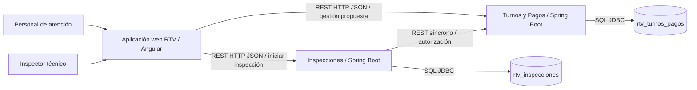
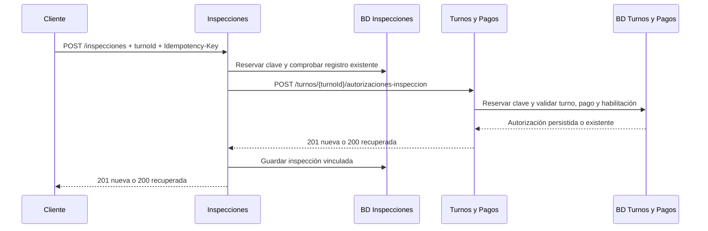

# PFC RTV · Referencia integral para GA-TL-02

**Proyecto elegido por GLMR:** Sistema de Revisión Técnica Vehicular (RTV) del Centro de Revisión Técnica Vehicular del Municipio de Valencia (CRTVMV).  
**Preparado para:** Bryan Lombeida, Carlos Manotoa y Eduardo Reinoso, con Kevin García como responsable de Gateway y comunicaciones.  
**Fecha de corte:** 24 de noviembre de 2026, Ecuador.  
**Propósito:** disponer de una base común de dominio, requisitos, código, contratos, datos, pruebas y antecedentes para diseñar la arquitectura del taller.

## Índice

1. Fuentes y estado de la información
2. Contexto, problema y proceso del centro
3. Actores y objetivos
4. Alcance existente y evolución
5. Requisitos funcionales con criterios
6. Requisitos no funcionales con métricas
7. Arquitectura y diagramas de E1
8. Componentes internos del prototipo
9. Datos y reglas de integridad
10. Flujo principal y contrato REST completo
11. Fallos, consistencia y recuperación
12. Decisiones arquitectónicas y puntos de revisión
13. Tecnologías y ejecución local
14. Pruebas, resultados y límites de la evidencia
15. Aplicación RTV de origen y funcionalidades disponibles
16. Referencias para cada integrante
17. Decisiones que debe cerrar GLMR
18. Inventario de rutas HTTP de la aplicación de origen
19. Inventario de entidades y pantallas
20. Catálogo de documentos y evidencias

## 1. Fuentes y estado de la información

| Fuente | Contenido y versión consultada |
|---|---|
| [Entrega académica E1](https://github.com/NixonPiguave/TA-PFC-E1-PFC-Entrega-1) | Informe, RF/RNF, C4, ADR, prototipo de dos servicios y pruebas. Commit `f675258e151c9458494707b4ae239afb9131636a`. |
| [Aplicación RTV de origen](https://github.com/NixonPiguave/AppWebRevisionVehicular) | Backend Spring Boot, frontend Angular, módulos funcionales y copia del prototipo. Rama `master`, commit `77d1ff6c38488fc02ab431472621ff4edb59f576`. |
| [Repositorio del taller GLMR](https://github.com/BryanLomb/GA-TL-02-FORM---Taller-Dise-o-de-Arquitectura-de-Microservicios-para-el-PFC) | Trabajo de Bryan, Kevin, Carlos y Eduardo. Kevin confirmó que RTV es el PFC elegido. |

Este documento consolida la documentación y una lectura estática del código publicado. Los resultados de pruebas se atribuyen a los registros de E1. La preparación de esta referencia comprendió lectura y contraste de esas fuentes. Cada enlace a código o documento de E1 identifica el commit consultado para que los compañeros puedan recuperar la misma versión.

Los conceptos siguientes tienen alcances diferentes dentro del proyecto.

- **Dominio del centro:** procesos y reglas descritos en la entrevista y el informe.
- **Requisito documentado:** necesidad o criterio que figura en los RF/RNF de E1.
- **Código de origen:** clases, rutas y pantallas presentes en la aplicación RTV amplia.
- **Prototipo distribuido E1:** implementación comprobada del intercambio de autorización e inicio entre dos servicios.
- **Diseño GA-TL-02:** acuerdos que debe producir GLMR sobre servicios, Gateway, componentes y canales.

Las decisiones nuevas del taller deberán precisar su relación con cada uno de esos alcances. La existencia de una clase o pantalla constituye evidencia de código disponible. Su aceptación por el centro y su comportamiento de extremo a extremo requieren sus propias comprobaciones.

**Lectura principal:** [README de E1](https://github.com/NixonPiguave/TA-PFC-E1-PFC-Entrega-1/blob/f675258e151c9458494707b4ae239afb9131636a/README.md) · [Informe PDF](https://github.com/NixonPiguave/TA-PFC-E1-PFC-Entrega-1/blob/f675258e151c9458494707b4ae239afb9131636a/docs/informe.pdf) · [Informe fuente](https://github.com/NixonPiguave/TA-PFC-E1-PFC-Entrega-1/blob/f675258e151c9458494707b4ae239afb9131636a/docs/informe.tex).

## 2. Contexto, problema y proceso del centro

El CRTVMV atiende vehículos del cantón Valencia, provincia de Los Ríos. El informe de E1 describe la verificación técnica, de seguridad y emisiones previa a la matriculación. Los puestos de atención comparten información de turno, pago, asignación de línea y resultados. La falta de confirmación entre puestos produce esperas, transcripciones y riesgo de iniciar revisiones con pago pendiente.

### 2.1. Recorrido de atención documentado

1. El guardia registra una ficha con el motivo de la visita.
2. Recepción genera el turno con pago pendiente.
3. El propietario realiza el pago en recaudación.
4. Recepción asigna una línea y el conductor acompaña al vehículo.
5. Los inspectores ejecutan y registran pruebas.
6. Digitación genera el resultado y recepción entrega el documento y las llaves identificadas por placa.

### 2.2. Reglas de dominio recogidas en E1

| Tema | Regla descrita en el informe | Uso en el taller |
|---|---|---|
| Pago y turno | Comprobar turno existente, habilitado y con pago confirmado antes del inicio | Regla crítica del contrato entre servicios |
| Defectos | El contexto registra rechazo por un defecto tipo III o cuatro tipo II | Regla de resultados pendiente de modelar en el alcance ampliado |
| Impronta | Se describe para cambios de color, motor, servicio o propietario | Relación entre historial del vehículo y trámite |
| Tarifas | El informe remite a categorías y tarifario de ANT | Conservar trazabilidad de categoría y tarifa |
| Citaciones | Se describe comprobación de pago o situación de impugnación | Validar fuente de verdad y disponibilidad de información externa |
| Transferencia de dominio | Se menciona comprobante del SRI para cambio de propietario | Precisar si se verifica por documento o por integración |
| Calendarización | E1 cita Resolución 008 de 2017 de ANT | Revisar el anexo y acordar la regla aplicable al caso |
| Vigencia de turnos | La entrevista describe validez hasta fin de mes y posterior reasignación | Acordar conservación de historia y relación con autorizaciones |

Estas reglas se reproducen como antecedentes del levantamiento de E1. El equipo debe validar el detalle operativo y la vigencia normativa cuando incorpore cada función al diseño.

### 2.3. Evidencia del problema

La encuesta de E1 contiene 17 respuestas. Según su informe, 12 de 17 gestionaron el último turno presencialmente, 15 de 17 esperaban informar o revisar el problema si el pago no podía comprobarse, 10 de 17 consultarían primero si una solicitud sin confirmación ya estaba registrada y 7 de 17 reportaron problemas de conexión frecuentes u ocasionales.

El informe deja pendientes los tiempos reales de atención, vehículos por día y frecuencia de interrupciones del centro. Las cifras de la encuesta sustentan necesidades. Los valores técnicos de latencia, espera y cantidades de prueba se definieron para el prototipo.

## 3. Actores y objetivos

| Actor | Participación |
|---|---|
| Propietario | Solicita trámite, paga y recibe resultado |
| Conductor | Acompaña el vehículo durante la revisión |
| Guardia | Registra ingreso y motivo |
| Recepcionista | Gestiona turno, asignación de línea y entrega de resultado |
| Recaudadora | Registra pagos y cobros del trámite |
| Técnico inspector | Ejecuta y registra pruebas |
| Digitadora | Consolida el resultado final |
| Supervisor y gerencia de calidad | Revisan trazabilidad y cumplimiento del proceso |
| Gerencia general | Consulta indicadores de gestión |
| Área de sistemas | Mantiene operación, despliegue y recuperación |
| ANT y SRI | Organismos externos mencionados en el contexto |

Los diagramas C4 de E1 agrupan los actores directos en **personal de atención** e **inspector técnico**. La aplicación de origen contiene además cuentas, roles, permisos y menús. La matriz detallada de permisos por cargo requiere acuerdo con el responsable del dominio.

### Objetivo general publicado

Desarrollar durante el período académico un sistema distribuido para el CRTVMV, organizado en Inspecciones y Turnos y Pagos, para compartir el estado de revisión entre puestos y gestionar fallos de servicios. El flujo crítico requiere confirmación de autorización antes de iniciar.

| Objetivo | Entrega prevista | Indicador de E1 |
|---|---|---|
| OE-1 | E1 | Especificar al menos 10 RF y 6 RNF con trazabilidad |
| OE-2 | E2 | Servicios independientes, contenedores, API OpenAPI y redespliegue independiente |
| OE-3 | E3 | Evitar duplicados con 10 reintentos y 2 solicitudes simultáneas, y rechazar pago sin confirmar |
| OE-4 | E4 | p95 local ≤100 ms con 1, 5 y 10 usuarios y gestión del fallo o demora superior a 3 s |

El detalle de validación de los orígenes de RF-01 a RF-05 está en la verificación de calidad de E1. Los criterios propuestos necesitan confirmación del centro sobre cuentas, roles, campos de auditoría y formato o duplicados de placa.

## 4. Alcance existente y evolución

| Elemento | Estado respaldado por las fuentes |
|---|---|
| Aplicación web amplia | Código Angular y backend Spring Boot con módulos de acceso, administración, catálogos, trámites, inspección y operación |
| Inspecciones y Turnos y Pagos separados | Prototipo E1 con dos procesos, dos bases y comunicación REST |
| Inicio de inspección | Implementado y cubierto por pruebas de E1 |
| Autorización de inicio | Implementada con validación, persistencia e idempotencia |
| Pago del prototipo | Estado preparado en datos de demostración y consultado al autorizar |
| Ficha y clasificación vehicular | RF documentados y código de origen disponible para revisión y migración |
| Autenticación del personal | Código de origen con JWT y gestión de sesiones; su integración en el prototipo distribuido es trabajo del diseño ampliado |
| Gateway | Propuesta de Kevin para el taller |
| Cliente móvil | La consigna del taller pide contemplar su entrada. En E1 se documenta cliente web Angular |
| Broker y eventos de negocio | Su necesidad se evaluará por interacción |
| Replicación distribuida | Evolución prevista para E3 y sujeta a diseño y prueba |
| OpenAPI y contenedores de los servicios | Objetivo de evolución de E2 |
| C4 nivel 3 y foto grupal GA-TL-02 | Entregables que desarrollará GLMR |

El dominio amplio y los diez RF deben quedar trazados en el taller. Los dos servicios del prototipo son el punto de partida para evaluar la descomposición. Bryan puede comparar alternativas y justificar ajustes con el equipo.

## 5. Requisitos funcionales con criterios

Se conservan los IDs, historias, criterios y referencias de la tabla RF de E1. La conversión siguiente pasa su contenido de LaTeX a Markdown. Los enlaces de la tabla original conservan las versiones históricas citadas por sus autores.

### RF-01

Como integrante autorizado del personal del CRTVMV, quiero autenticarme con mis credenciales personales para acceder a las funciones correspondientes a mis responsabilidades.

**Criterios de aceptación**

1. Con cuenta activa y credenciales válidas, se establece una sesión asociada al usuario.

2. Con credenciales inválidas, se rechaza el acceso sin crear una sesión.

3. Una cuenta deshabilitada no puede iniciar sesión, aunque su contraseña sea correcta.

4. Si falta usuario o contraseña, se solicita completar los campos y no se inicia sesión.

**Origen registrado en E1**

Código: [ingreso](https://github.com/NixonPiguave/AppWebRevisionVehicular/blob/77d1ff6c38488fc02ab431472621ff4edb59f576/backend/src/main/java/com/revisionvehicular/backend/controllers/AuthController.java). [ISO 29148](https://github.com/NixonPiguave/TA-PFC-E1-PFC-Entrega-1/blob/be245df8f15b1183f94bada0679adc18146016cd/docs/Anexos/Estado%20del%20arte/ISO-IEC-IEEE%2029148.pdf#page=74).

### RF-02

Como administrador del CRTVMV, quiero asignar roles existentes a una cuenta de usuario para que sus permisos correspondan a las labores que desempeña en el centro.

**Criterios de aceptación**

1. Un administrador autorizado puede asignar uno o más roles existentes a una cuenta registrada; la asignación se conserva al consultarla nuevamente.

2. Un usuario sin permiso no puede asignar roles ni alterar la asignación existente.

3. Si la cuenta o un rol no existe, se rechaza el cambio completo y se conservan las asignaciones anteriores.

4. Después de guardar un cambio, la siguiente solicitud protegida del usuario se evalúa con los permisos actualizados.

**Origen registrado en E1**

Código: [roles](https://github.com/NixonPiguave/AppWebRevisionVehicular/blob/77d1ff6c38488fc02ab431472621ff4edb59f576/backend/src/main/java/com/revisionvehicular/backend/service/srtv/UsuarioServiceImpl.java). [ISO 29148](https://github.com/NixonPiguave/TA-PFC-E1-PFC-Entrega-1/blob/be245df8f15b1183f94bada0679adc18146016cd/docs/Anexos/Estado%20del%20arte/ISO-IEC-IEEE%2029148.pdf#page=91).

### RF-03

Como administrador del CRTVMV, quiero restringir las funciones según los roles del personal para evitar consultas y modificaciones ajenas a las responsabilidades de cada cargo.

**Criterios de aceptación**

1. Una cuenta autenticada con el permiso requerido puede ejecutar la operación, sujeta a sus reglas de negocio.

2. Sin el permiso requerido, se deniega la operación sin revelar datos restringidos ni efectuar cambios.

3. Sin sesión válida, se rechaza el acceso a las funciones protegidas.

4. Las restricciones también se aplican al invocar directamente la operación, sin utilizar el menú de la aplicación.

**Origen registrado en E1**

Código: [permisos](https://github.com/NixonPiguave/AppWebRevisionVehicular/blob/77d1ff6c38488fc02ab431472621ff4edb59f576/backend/src/main/java/com/revisionvehicular/backend/service/admin/PostgresRolAdminService.java) y [conexión](https://github.com/NixonPiguave/AppWebRevisionVehicular/blob/77d1ff6c38488fc02ab431472621ff4edb59f576/backend/src/main/java/com/revisionvehicular/backend/config/DataSourceConfig.java). [ISO 29148](https://github.com/NixonPiguave/TA-PFC-E1-PFC-Entrega-1/blob/be245df8f15b1183f94bada0679adc18146016cd/docs/Anexos/Estado%20del%20arte/ISO-IEC-IEEE%2029148.pdf#page=74).

### RF-04

Como administrador del CRTVMV con permiso de auditoría, quiero consultar el registro de acciones de los usuarios autenticados para identificar quién realizó una operación y cuándo ocurrió.

**Criterios de aceptación**

1. Al completar una asignación de roles o un registro de placa, queda un registro consultable con usuario, fecha, hora, acción, identificador del registro afectado y resultado.

2. Los filtros por usuario, fecha o acción muestran únicamente los registros coincidentes.

3. Un usuario sin permiso de auditoría no puede consultar el historial.

4. Las funciones de la aplicación no permiten modificar ni eliminar los registros de auditoría.

5. Los registros no contienen contraseñas ni tokens de sesión completos.

**Origen registrado en E1**

[Encuesta E11](https://github.com/NixonPiguave/TA-PFC-E1-PFC-Entrega-1/blob/ccbbc93/evidencias/Encuesta%20RTV%20-%20TA-PFC-E1.csv); código: [auditoría](https://github.com/NixonPiguave/AppWebRevisionVehicular/blob/77d1ff6c38488fc02ab431472621ff4edb59f576/backend/src/main/java/com/revisionvehicular/backend/service/srtv/AuditoriaService.java).

### RF-05

Como inspector RTV, quiero registrar la placa en la ficha del vehículo para identificar la unidad a la que se asociarán las revisiones técnicas.

**Criterios de aceptación**

1. Con permisos, una placa válida y los demás datos obligatorios, el registro guarda la placa vinculada a la ficha y permite recuperarla al consultar.

2. Si falta la placa, se informa que es obligatoria y no se crea la ficha.

3. Si la placa incumple el formato validado con el responsable del dominio, se informa el error y no se guarda el registro.

4. Si ya existe una ficha para la placa en el mismo período de revisión, no se crea un duplicado y se conserva el registro existente.

**Origen registrado en E1**

Código: [ficha](https://github.com/NixonPiguave/AppWebRevisionVehicular/blob/77d1ff6c38488fc02ab431472621ff4edb59f576/backend/src/main/java/com/revisionvehicular/backend/service/cv/VehiculoServiceImpl.java) y [placa](https://github.com/NixonPiguave/AppWebRevisionVehicular/blob/77d1ff6c38488fc02ab431472621ff4edb59f576/backend/src/main/java/com/revisionvehicular/backend/dtos/cv/VehiculoDTO.java). [Res. 008](https://github.com/NixonPiguave/TA-PFC-E1-PFC-Entrega-1/blob/be245df8f15b1183f94bada0679adc18146016cd/docs/Anexos/RESOLUCION%20008-DIR-2017-ANT.pdf#page=53).

### RF-06

Como inspector RTV, quiero registrar el tipo de vehículo en su ficha para que la revisión se realice en la línea y con la tarifa que corresponden a esa categoría.

**Criterios de aceptación**

1. Con permisos y una ficha existente, el inspector puede seleccionar el tipo de vehículo de un catálogo validado con el centro; el tipo se guarda y se muestra al consultar la ficha.

2. Si no se selecciona el tipo, se informa que es obligatorio y no se continúa con la revisión.

3. No se aceptan tipos que no estén en el catálogo.

4. Si el tipo se modifica, la clasificación del vehículo (RF-10) se recalcula antes de asignar la línea.

**Origen registrado en E1**

Entrevista, P2 (vehículos y motocicletas) y P7 (tarifa según categoría).

### RF-07

Como inspector RTV, quiero registrar el uso o servicio del vehículo para identificar si cambió desde su última revisión y si el trámite requiere impronta.

**Criterios de aceptación**

1. Con permisos, el inspector puede seleccionar el uso del vehículo de un catálogo validado con el centro; el uso queda guardado en la ficha.

2. Si falta el uso, se informa que es obligatorio y no se guarda la ficha.

3. Si el uso registrado es distinto al de la revisión anterior del mismo vehículo, se indica que el trámite requiere impronta.

4. El cambio de uso queda en el registro de auditoría (RF-04) con el valor anterior y el nuevo.

**Origen registrado en E1**

Entrevista, P5 (impronta por cambio de servicio).

### RF-08

Como inspector RTV, quiero registrar el número de ejes del vehículo para que su clasificación y la línea asignada correspondan a su configuración.

**Criterios de aceptación**

1. Con permisos, el inspector puede registrar el número de ejes como un número entero dentro del rango validado con el centro; el valor queda guardado en la ficha.

2. Si el valor está vacío, no es entero o está fuera de rango, se informa el error y no se guarda.

3. Si el número de ejes no es compatible con el tipo de vehículo registrado (RF-06), se informa la inconsistencia y no se guarda.

4. Al modificar el número de ejes, se recalcula la clasificación (RF-10).

**Origen registrado en E1**

Entrevista, P6 (pruebas en la línea según el vehículo).

### RF-09

Como inspector RTV, quiero registrar el peso del vehículo para que su clasificación se determine con el dato que exige la norma.

**Criterios de aceptación**

1. Con permisos, el inspector puede registrar el peso en kilogramos como un valor positivo; el valor queda guardado en la ficha.

2. Si el peso está vacío, es cero, es negativo o no es numérico, se informa el error y no se guarda.

3. Si el peso está fuera del rango validado para el tipo de vehículo registrado, se solicita confirmación antes de guardarlo.

4. Al modificar el peso, se recalcula la clasificación (RF-10).

**Origen registrado en E1**

Entrevista, P7 (categoría del vehículo). NTE INEN 2656 (clasificación vehicular).

### RF-10

Como inspector RTV, quiero que el sistema clasifique automáticamente el vehículo según la norma NTE INEN 2656 para asignar la línea de revisión y la tarifa sin cálculos manuales.

**Criterios de aceptación**

1. Cuando la ficha tiene tipo, uso, número de ejes y peso registrados, el sistema asigna una categoría de la norma NTE INEN 2656 y la muestra en la ficha.

2. Si falta alguno de esos datos, no se asigna categoría y se indica qué dato falta.

3. Si los datos no corresponden a ninguna categoría, se informa la inconsistencia y no se puede asignar línea de revisión.

4. La categoría asignada es la que se usa para la tarifa y la asignación de la línea, y queda registrada con la fecha de clasificación.

**Origen registrado en E1**

Entrevista, P6 y P7 (líneas y tarifa por categoría). NTE INEN 2656.

## 6. Requisitos no funcionales con métricas

Estos RNF se aplican al flujo de autorización e inicio del prototipo. El objetivo de p95 es local. La configuración de 3 s limita la espera de la dependencia. Su aplicación a un despliegue con Gateway exige medir el recorrido ampliado.

### RNF-01 · Eficiencia de desempeño: comportamiento temporal.

Rendimiento de la autorización. Medir el tiempo de respuesta con 1, 5 y 10 usuarios simultáneos, con 100 solicitudes totales por escenario y turnos independientes, válidos y pagados.

 Métrica: percentil 95 (p95) del tiempo, en milisegundos, observado por el cliente desde el envío de la solicitud de inicio hasta recibir por completo su respuesta, incluida la consulta de Inspecciones a Turnos y Pagos. La medición incluye el transporte HTTP local y no representa un tiempo interno instrumentado en el servidor. Registrar también códigos de respuesta y porcentaje de errores.

 Umbral: p95 ≤ 100 ms en cada escenario de 1, 5 y 10 usuarios simultáneos, con 100 solicitudes medidas por escenario. Se aplica al entorno local documentado; es un criterio técnico inicial definido al revisar la prueba exploratoria.

 Comprobación: conservar las 100 mediciones de cada escenario y calcular el p95. La tabla (referencia en informe E1: tab:p95-nixon) presenta las mediciones obtenidas y su comparación con el criterio inicial.

**Estado registrado en E1**

Condiciones propuestas, 18-11-2026; medición y criterio inicial, 20-11-2026.

### RNF-02 · Fiabilidad: tolerancia a fallos.

Fallo de comunicación. Configurar una espera máxima de 3 segundos para la llamada de Inspecciones a Turnos y Pagos. En el 100 % de los casos probados de servicio no disponible o respuesta demorada, Inspecciones informará que no pudo confirmar la autorización y no iniciará la inspección.

 Métrica: casos que aplican el comportamiento previsto / casos de fallo ejecutados, por 100.

 Comprobación: detener Turnos y Pagos y, en otro caso independiente, demorar su respuesta más de 3 segundos. Revisar la respuesta de Inspecciones y la ausencia de una inspección nueva. Los 3 segundos limitan la espera configurada; no garantizan el tiempo de respuesta del servicio remoto.

**Estado registrado en E1**

Criterio técnico propuesto el 18-11-2026; comprobado el 21-11-2026 en el entorno registrado.

### RNF-03 · Fiabilidad: ausencia de fallos en las condiciones definidas.

Integridad del estado de negocio. El 100 % de los intentos con turno inexistente, pago sin confirmar o turno no habilitado se rechazará sin crear una autorización válida ni iniciar una inspección.

 Métrica: intentos inválidos correctamente rechazados / intentos inválidos ejecutados, por 100; número de autorizaciones válidas e inspecciones creadas en esos intentos: 0.

 Condiciones y comprobación: ejecutar al menos 3 casos por cada condición, al menos 9 en total, y comparar los registros de ambas bases antes y después. Añadir un control con turno válido, habilitado y pagado para comprobar que el rechazo no sea indiscriminado.

**Estado registrado en E1**

Criterio técnico propuesto el 18-11-2026; comprobado el 21-11-2026 en el entorno registrado.

### RNF-04 · Fiabilidad: ausencia de fallos ante reintentos y concurrencia.

Control de duplicados. Diez repeticiones de una solicitud válida, con la misma clave de idempotencia y el mismo contenido, producirán exactamente una autorización identificada. En un escenario independiente, dos solicitudes simultáneas de inicio para un mismo turno válido no producirán más de una inspección activa, incluso si usan claves distintas.

 Métricas: autorizaciones nuevas para la solicitud repetida: 1; inspecciones activas para el turno del escenario concurrente: como máximo 1.

 Comprobación: usar un turno nuevo por escenario, conservar claves y respuestas, sincronizar las dos solicitudes concurrentes y consultar ambas bases para contar los registros correspondientes.

**Estado registrado en E1**

Criterio técnico propuesto el 18-11-2026; comprobado el 21-11-2026 en el entorno registrado.

### RNF-05 · Fiabilidad: capacidad de recuperación.

Persistencia tras reinicios. Después de reiniciar de forma controlada ambos servicios y PostgreSQL, se conservará el 100 % de los 10 registros confirmados seleccionados para la prueba, con los mismos identificadores y estados.

 Métrica: registros conservados con identificador y estado coincidentes / 10 registros confirmados, por 100.

 Comprobación: preparar el conjunto de 10 registros y documentar su distribución entre las dos bases; obtener un inventario previo, realizar los reinicios y comparar el inventario posterior. El alcance es la conservación de datos confirmados ante reinicios, no la recuperación de transacciones sin confirmar ni la restauración de respaldos.

**Estado registrado en E1**

Criterio técnico propuesto el 18-11-2026; comprobado el 21-11-2026 en el entorno registrado.

### RNF-06 · Seguridad: autenticidad y control de acceso.

Acceso entre servicios. El 100 % de las solicitudes sin credencial válida al punto de autorización de Turnos y Pagos se rechazará sin modificar turnos, pagos o autorizaciones.

 Métrica: solicitudes no autenticadas correctamente rechazadas / 10 intentos no autenticados, por 100; modificaciones de datos de negocio provocadas por estos intentos: 0.

 Comprobación: realizar 5 solicitudes sin credencial y 5 con credencial incorrecta, y después un control con credencial válida y turno elegible. Comparar respuestas y estado de negocio. El prototipo implementa un token compartido entre servicios. La comprobación adicional ejecutó cinco peticiones sin credencial y cinco con una credencial incorrecta, además del control válido; contrastó el estado de negocio antes y después. Las credenciales no se incluyen en archivos versionados ni en las evidencias publicadas.

**Estado registrado en E1**

Criterio técnico propuesto el 18-11-2026; cinco repeticiones por condición comprobadas el 21-11-2026.

### Punto de trazabilidad que debe resolver GLMR

Los RF-01 a RF-04 cubren acceso, roles y auditoría. Los RF-05 a RF-10 cubren datos y clasificación del vehículo. La autorización, el pago y el inicio aparecen en objetivos, RNF, contrato y prototipo, pero requieren una relación funcional explícita en la tabla de servicios del taller. Bryan y el equipo deben documentar esa relación y acordar cualquier ampliación de los RF conservando los IDs existentes.

La revisión de origen y validación está documentada en [Verificación de calidad E1](https://github.com/NixonPiguave/TA-PFC-E1-PFC-Entrega-1/blob/f675258e151c9458494707b4ae239afb9131636a/docs/calidad/verificacion-e1.md).

## 7. Arquitectura y diagramas de E1

### 7.1. C4 de contexto

El sistema RTV recibe solicitudes del personal de atención y del inspector técnico. El primero gestiona turnos y pagos. El segundo consulta condiciones y registra revisión, mediciones, observaciones y resultado. Las respuestas comunican estados y confirmaciones.

### 7.2. C4 de contenedores



Esta representación resume el C4 N2 de E1. El cliente web y las operaciones completas de gestión representan el alcance de diseño. La demostración usa un cliente HTTP para ejercitar los endpoints implementados.

| Archivo | Uso |
|---|---|
| [docs/diagramas/c4-contexto-rtv.drawio](https://github.com/NixonPiguave/TA-PFC-E1-PFC-Entrega-1/blob/f675258e151c9458494707b4ae239afb9131636a/docs/diagramas/c4-contexto-rtv.drawio) | Fuente editable C4 N1 |
| [docs/diagramas/c4-contexto-rtv.png](https://github.com/NixonPiguave/TA-PFC-E1-PFC-Entrega-1/blob/f675258e151c9458494707b4ae239afb9131636a/docs/diagramas/c4-contexto-rtv.png) | Imagen C4 N1 |
| [docs/diagramas/c4-contenedores-rtv-final.drawio](https://github.com/NixonPiguave/TA-PFC-E1-PFC-Entrega-1/blob/f675258e151c9458494707b4ae239afb9131636a/docs/diagramas/c4-contenedores-rtv-final.drawio) | Fuente editable N2 disponible y usada en la entrega |
| [docs/diagramas/c4-contenedores.drawio.png](https://github.com/NixonPiguave/TA-PFC-E1-PFC-Entrega-1/blob/f675258e151c9458494707b4ae239afb9131636a/docs/diagramas/c4-contenedores.drawio.png) | Exportación publicada N2 |

Algunos documentos históricos enlazan nombres anteriores de contenedores. Para recuperar el editable publicado, usar el archivo terminado en `-final.drawio` de la tabla.

## 8. Componentes internos del prototipo

Los componentes siguientes se identifican en el código E1 y orientan el C4 N3 de Carlos.

| Unidad | Clase o artefacto | Responsabilidad |
|---|---|---|
| Turnos y Pagos | `TurnosApp` | Arranque Spring Boot |
| Turnos y Pagos | `Autorizaciones`, dentro de `Autorizacion.java` | Endpoint de autorización, validación de credencial, reglas de turno/pago y transacción local |
| Turnos y Pagos | `JdbcTemplate` y `TransactionTemplate` | Acceso SQL y transacción que protege la decisión |
| Turnos y Pagos | `schema.sql` | Claves, turnos, pagos y autorizaciones |
| Inspecciones | `InspeccionesApp` | Arranque Spring Boot |
| Inspecciones | `Inspecciones` | Endpoint de inicio, recuperación de registro existente e inserción local |
| Inspecciones | `ClienteTurnos` | Cliente HTTP, llamada al proveedor, validación de respuesta y traducción de fallos |
| Inspecciones | `JdbcTemplate` y `schema.sql` | Persistencia de claves e inspecciones |
| Código compartido | `Api` en `soporte-http` | Validación y representación controlada de errores |
| Código compartido | `Claves` en `soporte-http` | Reserva y asociación persistente de clave con turno |

`soporte-http` se reutiliza como módulo de código de ambos procesos. Su participación en el diagrama corresponde a una dependencia de software compartido. Carlos debe representar los componentes lógicos y las aplicaciones desplegables según su función.

En la implementación pequeña, `Autorizaciones` concentra endpoint y lógica con acceso SQL. Una futura separación en API, aplicación, dominio y persistencia puede proponerse como refactor del taller, indicando qué elementos ya existen y cuáles se diseñan.

**Código para revisar:** [Autorizaciones](https://github.com/NixonPiguave/TA-PFC-E1-PFC-Entrega-1/blob/f675258e151c9458494707b4ae239afb9131636a/src/turnos-pagos/src/main/java/Autorizacion.java) · [Inspecciones](https://github.com/NixonPiguave/TA-PFC-E1-PFC-Entrega-1/blob/f675258e151c9458494707b4ae239afb9131636a/src/inspecciones/src/main/java/Inspecciones.java) · [Cliente HTTP](https://github.com/NixonPiguave/TA-PFC-E1-PFC-Entrega-1/blob/f675258e151c9458494707b4ae239afb9131636a/src/inspecciones/src/main/java/ClienteTurnos.java) · [Api](https://github.com/NixonPiguave/TA-PFC-E1-PFC-Entrega-1/blob/f675258e151c9458494707b4ae239afb9131636a/soporte-http/src/main/java/ec/rtv/e1/Api.java) · [Claves](https://github.com/NixonPiguave/TA-PFC-E1-PFC-Entrega-1/blob/f675258e151c9458494707b4ae239afb9131636a/soporte-http/src/main/java/ec/rtv/e1/Claves.java).

## 9. Datos y reglas de integridad

### 9.1. Propiedad del prototipo

| Dueño | Base | Información que conserva |
|---|---|---|
| Turnos y Pagos | `rtv_turnos_pagos` | Turno, habilitación, pago confirmado, clave y autorización |
| Inspecciones | `rtv_inspecciones` | Clave, ID de inspección, turno asociado e ID de autorización |

La referencia al turno y a la autorización en Inspecciones usa identificadores recibidos por contrato. Las claves foráneas declaradas en sus esquemas son locales a cada base.

### 9.2. Esquemas SQL publicados

**src/turnos-pagos/src/main/resources/schema.sql**

```sql
create table if not exists claves (
    clave varchar(128) primary key,
    turno_id bigint not null check (turno_id > 0),
    unique (clave, turno_id)
);

create table if not exists turnos (
    id bigint primary key check (id > 0),
    habilitado boolean not null
);

create table if not exists pagos (
    turno_id bigint primary key references turnos(id),
    confirmado boolean not null
);

create table if not exists autorizaciones (
    id uuid primary key,
    turno_id bigint not null unique references turnos(id),
    clave varchar(128) not null unique,
    foreign key (clave, turno_id) references claves(clave, turno_id)
);
```

Fuente [src/turnos-pagos/src/main/resources/schema.sql](https://github.com/NixonPiguave/TA-PFC-E1-PFC-Entrega-1/blob/f675258e151c9458494707b4ae239afb9131636a/src/turnos-pagos/src/main/resources/schema.sql).

**src/inspecciones/src/main/resources/schema.sql**

```sql
create table if not exists claves (
    clave varchar(128) primary key,
    turno_id bigint not null check (turno_id > 0),
    unique (clave, turno_id)
);

create table if not exists inspecciones (
    id uuid primary key,
    turno_id bigint not null unique,
    autorizacion_id uuid not null unique,
    clave varchar(128) not null unique,
    foreign key (clave, turno_id) references claves(clave, turno_id)
);
```

Fuente [src/inspecciones/src/main/resources/schema.sql](https://github.com/NixonPiguave/TA-PFC-E1-PFC-Entrega-1/blob/f675258e151c9458494707b4ae239afb9131636a/src/inspecciones/src/main/resources/schema.sql).

### 9.3. Invariantes y observaciones

- Una clave se asocia a un turno en cada servicio y conserva esa asociación después de fallos parciales.
- `autorizaciones.turno_id` y `autorizaciones.clave` son únicos.
- `inspecciones.turno_id`, `autorizacion_id` y `clave` son únicos.
- Turnos y Pagos bloquea el turno y consulta el pago durante la transacción de autorización.
- Inspecciones realiza su inserción local después de recibir y validar la autorización.
- La respuesta de Inspecciones usa el estado `INICIADA`. En este esquema mínimo ese valor se construye en el código al leer el registro.
- El prototipo conserva una autorización y una inspección por turno. Reinspecciones y reaperturas requieren un modelo acordado.
- Ambas bases pueden residir en la misma instalación PostgreSQL de demostración. Esta instalación constituye una dependencia común de infraestructura.

Bryan debe definir además el dueño de usuarios, roles, permisos, auditoría, ficha vehicular, clasificación y catálogos al cubrir los RF completos del taller. El esquema mínimo sirve como evidencia del intercambio ya implementado.

## 10. Flujo principal y contrato REST completo



El recorrido corresponde al caso nuevo o pendiente de recuperación. Si Inspecciones ya tiene el registro para esa clave, devuelve el existente desde su base. El Gateway se incorporará en el diseño del taller como entrada para los clientes.

### Contrato E1 v0.2

Se incorpora a continuación el contenido del contrato acordado para que el equipo tenga sus detalles en este mismo archivo.

### Contrato REST: autorización para iniciar una inspección

**Proyecto:** Sistema de Revisión Técnica Vehicular (RTV).  
**Actividad:** TA-PFC-E1.  
**Versión:** 0.2.  
**Estado:** Acordado para el esqueleto E1, 20 de noviembre de 2026.  
**Responsables:** Kevin García — arquitectura; Diego Giraldo — desarrollo.

#### 1. Flujo y responsabilidades

Inspecciones solicita una autorización a Turnos y Pagos antes de registrar un nuevo inicio. Turnos y Pagos comprueba el turno, su habilitación y el pago confirmado, y guarda la autorización en su propia base. Inspecciones recibe esa autorización y guarda el inicio en su base.

La operación consulta el pago registrado; no realiza un cobro ni convierte un pago pendiente en confirmado.

Los dos servicios utilizan Java y Spring Boot, REST con HTTP/JSON y bases PostgreSQL separadas. Cada servicio accede a sus propios datos y credenciales. HTTP se utiliza en la demostración local; un despliegue externo requiere HTTPS.

#### 2. Solicitud entre servicios

**Consumidor:** Inspecciones.  
**Proveedor:** Turnos y Pagos.  
**Método y ruta:** `POST /turnos/{turnoId}/autorizaciones-inspeccion`.

Se utiliza POST porque se crea una autorización persistente.

| Dato | Formato |
| --- | --- |
| `turnoId` | Entero positivo de 64 bits, en la ruta. |
| `Content-Type` | `application/json`. |
| `Idempotency-Key` | Clave de 1 a 128 caracteres: letras ASCII, números, punto, guion y guion bajo. |
| `Authorization` | `Bearer <credencial-del-servicio>`, configurada mediante `RTV_SERVICE_TOKEN`. |
| `X-Request-Id` | Identificador de correlación que Inspecciones envía para relacionar los registros de ambos servicios. |
| Cuerpo | Objeto JSON vacío: `{}`. |

La clave identifica una operación y se conserva en los reintentos. Puede utilizarse un UUID, pero no es el único formato admitido.

Ejemplo con identificadores ficticios:

```http
POST /turnos/123/autorizaciones-inspeccion
Content-Type: application/json
Accept: application/json
Idempotency-Key: 6d243573-882e-4f8e-b858-a801391e5d91
Authorization: Bearer <credencial-del-servicio>

{}
```

#### 3. Validaciones y persistencia

El proveedor comprueba la credencial, el identificador del turno, la clave y el cuerpo JSON. Reserva la asociación entre clave y turno y, dentro de la transacción de autorización, comprueba el turno, el pago y la habilitación.

La autorización de un turno ya existente se recupera cuando la clave coincide. Otra clave para ese turno se rechaza. Las restricciones de unicidad y el bloqueo del turno protegen la operación ante solicitudes simultáneas.

En E1 se permite una sola autorización y una sola inspección por turno. Las reinspecciones y la revocación de autorizaciones requieren reglas adicionales.

#### 4. Respuesta de Turnos y Pagos

Una autorización nueva devuelve `201 Created`. La repetición de una operación ya completada, con la misma clave y el mismo turno, devuelve `200 OK` con los mismos identificadores.

```json
{
  "autorizacionId": "d747ef3b-ef2d-4c55-8b87-f4a91ac01234",
  "turnoId": 123
}
```

| Campo | Tipo y significado |
| --- | --- |
| `autorizacionId` | UUID representado como texto; identifica la autorización guardada. |
| `turnoId` | Entero positivo; identifica el turno autorizado. |

Esta es la respuesta mínima acordada para E1. La comprobación del pago corresponde al proveedor y ocurre antes de crear la autorización.

#### 5. Errores del proveedor

Los errores de negocio y validación tienen un único campo `codigo`:

```json
{
  "codigo": "PAGO_NO_CONFIRMADO"
}
```

| HTTP | Código | Significado |
| --- | --- | --- |
| `400` | `SOLICITUD_INVALIDA` | Identificador, clave o cuerpo JSON inválidos. |
| `401` | `CREDENCIAL_INVALIDA` | Credencial del servicio ausente o incorrecta. |
| `404` | `TURNO_INEXISTENTE` | El turno no existe. |
| `409` | `PAGO_NO_CONFIRMADO` | El pago no está confirmado. |
| `409` | `TURNO_NO_HABILITADO` | El turno no permite iniciar la inspección. |
| `409` | `TURNO_YA_AUTORIZADO` | Otra clave ya produjo una autorización para ese turno. |
| `409` | `CLAVE_REUTILIZADA` | La clave está asociada a otro turno. |
| `415` | `FORMATO_NO_SOPORTADO` | El tipo de contenido no es compatible con la operación. |
| `503` | `PERSISTENCIA_NO_DISPONIBLE` | Falló el acceso a la base de datos. |

Los errores no incluyen consultas SQL, contraseñas ni detalles internos.

#### 6. Idempotencia y recuperación

Inspecciones conserva la clave antes de llamar al proveedor. Ambos servicios mantienen su asociación al turno aunque falle un paso posterior. Un reintento debe usar esa clave y ese turno; una operación diferente utiliza otra clave.

| Situación | Comportamiento |
| --- | --- |
| Misma clave y mismo turno con autorización existente | Devolver la autorización original con `200`. |
| Misma clave y otro turno | Rechazar con `409 CLAVE_REUTILIZADA`. |
| Otra clave para un turno autorizado | Rechazar con `409 TURNO_YA_AUTORIZADO`. |
| Peticiones simultáneas | Conservar una sola autorización y una sola inspección por turno. |
| Autorización guardada y fallo antes del registro local | Recuperar la misma autorización y completar la inspección con la clave original. |

Las escrituras de los dos servicios son transacciones locales independientes. Puede existir temporalmente una autorización sin inspección registrada. Un nuevo inicio se confirma después de guardar la inspección vinculada.

#### 7. Registro de Inspecciones

El cliente llama a `POST /inspecciones`, con `Content-Type: application/json`, la cabecera `Idempotency-Key` y este cuerpo:

```json
{
  "turnoId": 123
}
```

Inspecciones guarda su UUID, el turno, el UUID de autorización y la clave. Devuelve `201` al crear el registro o `200` al recuperar el existente:

```json
{
  "inspeccionId": "b4fd4b48-f219-4f14-b44a-7cc8e1956789",
  "turnoId": 123,
  "autorizacionId": "d747ef3b-ef2d-4c55-8b87-f4a91ac01234",
  "estado": "INICIADA"
}
```

Los identificadores del ejemplo son ficticios. La credencial Bearer descrita en este contrato protege la llamada entre los servicios.

#### 8. Fallos de comunicación

La llamada utiliza `TURNOS_TIMEOUT`, configurado inicialmente en `3s`. Es el límite de espera del consumidor, no una garantía de rendimiento del proveedor.

| Respuesta de Inspecciones | Situación |
| --- | --- |
| `503 TURNOS_NO_DISPONIBLE` | No se puede completar la comunicación o el proveedor devuelve un error del servidor. |
| `504 TURNOS_TIEMPO_AGOTADO` | Se agota el tiempo de espera. |
| `502 RESPUESTA_TURNOS_INVALIDA` | La respuesta no tiene el formato, código o identificadores esperados. |
| `503 PERSISTENCIA_NO_DISPONIBLE` | Falla la persistencia local de Inspecciones. |

Los rechazos conocidos `404` y `409` del proveedor se conservan al responder al cliente. Los demás errores recibidos se tratan según la validación del cliente HTTP; no se presupone que todos se propaguen con el mismo código.

Una respuesta perdida no significa que la autorización no se haya guardado. Inspecciones conserva la clave y permite reintentar de forma explícita. No confirma un nuevo inicio sin autorización válida ni modifica el pago.

#### 9. Verificación

Las pruebas de integración cubren el inicio válido, los rechazos, los reintentos, la concurrencia, las credenciales, el reinicio de aplicaciones y la recuperación después de un fallo de comunicación o escritura.

Los diez casos ejecutados se describen en [la revisión del esqueleto](https://github.com/NixonPiguave/TA-PFC-E1-PFC-Entrega-1/blob/f675258e151c9458494707b4ae239afb9131636a/docs/arquitectura/revision-esqueleto.md), junto con [el registro de resultados](https://github.com/NixonPiguave/TA-PFC-E1-PFC-Entrega-1/blob/f675258e151c9458494707b4ae239afb9131636a/docs/arquitectura/resultado-integracion-kevin.txt). La tabla de diferencias de esa revisión corresponde a la comparación con la versión 0.1.

## 11. Fallos, consistencia y recuperación

| Escenario | Estado posible | Respuesta y recuperación |
|---|---|---|
| Pago pendiente o turno no habilitado | Clave reservada; autorización sin crear | Rechazo de negocio; revisar condición y reintentar conforme al contrato |
| Turnos y Pagos detenido | Solicitud de inicio sin confirmación | Inspecciones responde 503 |
| Dependencia demora más de 3 s | El proveedor podría continuar procesando | Inspecciones responde 504 y conserva clave |
| Proveedor guarda autorización y pierde respuesta | Autorización persistida; inspección todavía pendiente | Repetir misma clave y turno y recuperar autorización |
| Inspecciones falla al guardar después de autorizar | Autorización persistida; registro local pendiente | Reintento recupera autorización y completa registro |
| Misma clave y turno repetidos | Resultado existente | 200 con mismos identificadores |
| Otra clave para turno ya autorizado | Operación duplicada por turno | 409 `TURNO_YA_AUTORIZADO` |
| Reinicio de ambos procesos y PostgreSQL | Registros confirmados en bases | Comprobar conservación de identificadores, relaciones y estados |
| Falla del Gateway futuro | Entrada pública afectada | Eduardo debe analizar disponibilidad y recuperación del nuevo componente |

Cada servicio usa transacciones locales. Se admite una autorización persistida con inspección pendiente de registro. La regla de integridad exige autorización válida antes de confirmar un nuevo inicio. Las restricciones y la clave permiten recuperar la operación sin duplicación.

El análisis de CAP/PACELC de E1 orienta las operaciones críticas a priorizar consistencia durante una partición y aceptar latencia de coordinación en condiciones normales. La replicación y el comportamiento ante particiones entre copias quedan sujetos al desarrollo posterior. El ensayo de detener un servicio verifica una dependencia caída.

La vigencia de una autorización después de cancelar el turno o cambiar el pago, la revocación y las reinspecciones requieren reglas adicionales. Eduardo debe evaluar esos flujos según el alcance que acuerden Bryan y el equipo. El prototipo recupera una autorización ya creada mediante la misma clave.

**Fuente de análisis:** [CAP/PACELC E1](https://github.com/NixonPiguave/TA-PFC-E1-PFC-Entrega-1/blob/f675258e151c9458494707b4ae239afb9131636a/docs/arquitectura/analisis-cap-pacelc.md) · [ADR-002](https://github.com/NixonPiguave/TA-PFC-E1-PFC-Entrega-1/blob/f675258e151c9458494707b4ae239afb9131636a/docs/adr/ADR-002-comunicacion.md).

## 12. Decisiones arquitectónicas y puntos de revisión

| Registro | Estado textual en su archivo | Decisión |
|---|---|---|
| ADR-001 | Propuesto, pendiente de revisión con Diego Giraldo | Separar RTV en Turnos y Pagos e Inspecciones, con bases propias |
| ADR-002 | Aceptado para el esqueleto E1 por arquitectura y desarrollo, 20 de noviembre de 2026 | Autorización mediante REST síncrono, clave de idempotencia y espera configurada |

El código y las pruebas muestran el intercambio de dos servicios, aunque ADR-001 conserva su estado textual de propuesta. GLMR debe registrar con claridad qué antecedentes adopta para su propio diseño y qué cambia.

### Alternativas consideradas en E1

- Aplicación modular única, con menor costo de coordinación local.
- Separación con bases privadas, elegida para demostrar límites e intercambio distribuido.
- REST síncrono para obtener la autorización antes de continuar.
- gRPC como alternativa con contrato tipado que exige justificación y medición propia.
- Mensajería como alternativa que exige estados pendientes y gestión de entrega.

La incorporación de Gateway, la redistribución del dominio o un mecanismo diferente pueden requerir un nuevo ADR según la decisión efectivamente modificada. Al corte consultado, E1 contiene ADR-001 y ADR-002. El siguiente número debe verificarse en el repositorio del taller al crear el nuevo registro.

**Archivos:** [docs/adr/ADR-001-estilo-arquitectura.md](https://github.com/NixonPiguave/TA-PFC-E1-PFC-Entrega-1/blob/f675258e151c9458494707b4ae239afb9131636a/docs/adr/ADR-001-estilo-arquitectura.md) · [docs/adr/ADR-002-comunicacion.md](https://github.com/NixonPiguave/TA-PFC-E1-PFC-Entrega-1/blob/f675258e151c9458494707b4ae239afb9131636a/docs/adr/ADR-002-comunicacion.md).

## 13. Tecnologías y ejecución local

| Pieza | Tecnología documentada |
|---|---|
| Prototipo E1 | Java 21, Spring Boot 4.0.1, Maven multimódulo |
| Persistencia del prototipo | PostgreSQL, JDBC, JdbcTemplate y transacciones locales |
| Backend de origen | Java 21, Spring Boot 4.0.1, JPA, Spring Security y bibliotecas JWT |
| Frontend de origen | Angular 21, RxJS y TypeScript |
| Pruebas E1 | Node.js 22 o posterior, curl y herramientas PostgreSQL |
| Documento E1 | pdfLaTeX, Biber y biblatex IEEE |

### Direcciones de demostración E1

| Componente | Dirección local |
|---|---|
| Turnos y Pagos | `http://127.0.0.1:8081` |
| Inspecciones | `http://127.0.0.1:8082` |
| PostgreSQL | `127.0.0.1:55432` |

La verificación complementaria empleó otros puertos, 18081, 18082 y 55433, para aislar sus datos ficticios.

### Configuración necesaria

| Variable | Propósito |
|---|---|
| `TURNOS_DB_URL`, `TURNOS_DB_USER`, `TURNOS_DB_PASSWORD` | Conexión privada de Turnos y Pagos |
| `INSPECCIONES_DB_URL`, `INSPECCIONES_DB_USER`, `INSPECCIONES_DB_PASSWORD` | Conexión privada de Inspecciones |
| `RTV_SERVICE_TOKEN` | Credencial compartida entre los servicios del prototipo |
| `TURNOS_URL` | Dirección que usa el cliente HTTP de Inspecciones |
| `TURNOS_TIMEOUT` | Espera de la llamada, inicialmente `3s` |
| `TURNOS_PORT`, `INSPECCIONES_PORT` | Puertos de los procesos |
| `RTV_BIND_ADDRESS` | Dirección de escucha, por defecto `127.0.0.1` |

Los valores de credenciales se generan para cada entorno y se mantienen fuera del documento y del repositorio. El prototipo usa HTTP local. La exposición fuera de esa demostración requiere acordar transporte seguro, identidad y políticas del Gateway.

### Procedimiento resumido para reproducir el caso

1. Clonar E1 y disponer de JDK 21, Maven, PostgreSQL y Node.js.
2. Preparar un clúster y dos bases de prueba siguiendo el README.
3. Cargar las variables de entorno y generar las credenciales locales.
4. Compilar con `mvn package`.
5. Arrancar los JAR de Turnos y Pagos e Inspecciones en terminales configuradas.
6. Cargar los datos ficticios de `src/turnos-pagos/db/demo.sql`.
7. Enviar la petición de inicio y repetirla con la misma clave.
8. Ejecutar la suite según el procedimiento del README, que inicia sus propios procesos.

Ejemplo con turno ficticio 101, una vez preparados los datos

```powershell
'{"turnoId":101}' | curl.exe -i http://127.0.0.1:8082/inspecciones -H 'Content-Type: application/json' -H 'Idempotency-Key: demo-101' --data-binary '@-'
```

Se espera 201 en la creación y 200 al recuperar la operación. La suite de calidad realiza reinicios sobre el clúster ficticio que se le indica. El procedimiento completo y los requisitos de reproducción están en [README E1](https://github.com/NixonPiguave/TA-PFC-E1-PFC-Entrega-1/blob/f675258e151c9458494707b4ae239afb9131636a/README.md) y [verificación de calidad](https://github.com/NixonPiguave/TA-PFC-E1-PFC-Entrega-1/blob/f675258e151c9458494707b4ae239afb9131636a/docs/calidad/verificacion-e1.md).

## 14. Pruebas, resultados y límites de la evidencia

E1 conserva dos mediciones. La primera es exploratoria y contribuyó a definir el criterio local. La segunda aplicó el límite de 100 ms ya fijado y verificó el repositorio académico desde un clon limpio.

| Ejecución | Fecha local Ecuador | Usuarios | p95 en ms |
|---|---|---|---|
| Inicial | 20 de noviembre de 2026 | 1 / 5 / 10 | 14,256 / 25,982 / 47,432 |
| Verificación complementaria | 21 de noviembre de 2026 | 1 / 5 / 10 | 14,303 / 26,562 / 54,367 |

Cada escenario usó 100 solicitudes medidas y 10 de calentamiento. El resultado registrado para los escenarios fue 0 % de errores. Las ejecuciones son locales, con cliente, servicios y bases en el mismo equipo.

### Resultados complementarios publicados

| RNF o caso | Evidencia registrada |
|---|---|
| RNF-01 | Los tres p95 de la segunda corrida satisfacen el límite local de 100 ms |
| RNF-02 | 503 con proveedor detenido, 504 por demora, sin inspecciones antes del reintento y recuperación con misma clave |
| RNF-03 | Nueve casos inválidos, tres por condición, con cero autorizaciones válidas e inspecciones; control válido 201 |
| RNF-04 | Diez reintentos con una autorización y una inspección; dos solicitudes concurrentes sin duplicación |
| RNF-05 | Diez inspecciones y diez autorizaciones conservadas tras reiniciar servicios y PostgreSQL |
| RNF-06 | Cinco solicitudes sin credencial y cinco incorrectas, diez rechazos 401 y datos de negocio conservados |
| Restauración | Respaldo y restauración de dos bases en un ensayo controlado con comparación del contenido |

El entorno registrado incluye Intel Core i7-8700, 12 procesadores lógicos, aproximadamente 15,92 GiB de RAM reconocida, JDK 21.0.13.1, Node.js 24.15.0 y PostgreSQL 18.1. La corrida complementaria identifica como base de ejecución el commit `877bb16de24e18f6d5ae470844603142028425d0`.

### Alcance de las conclusiones

Los resultados corresponden a los casos, código, red y datos sintéticos registrados. Las pruebas del Gateway, de nuevos servicios o del despliegue en contenedores requerirán nuevas evidencias. La aceptación de requisitos por el centro se documentará con su validación de dominio.

**Evidencia original:** [Informe de calidad](https://github.com/NixonPiguave/TA-PFC-E1-PFC-Entrega-1/blob/f675258e151c9458494707b4ae239afb9131636a/docs/calidad/verificacion-e1.md) · [Resumen complementario](https://github.com/NixonPiguave/TA-PFC-E1-PFC-Entrega-1/blob/f675258e151c9458494707b4ae239afb9131636a/evidencias/verificacion-calidad/resumen.json) · [Entorno](https://github.com/NixonPiguave/TA-PFC-E1-PFC-Entrega-1/blob/f675258e151c9458494707b4ae239afb9131636a/evidencias/verificacion-calidad/entorno.json) · [Medición inicial](https://github.com/NixonPiguave/TA-PFC-E1-PFC-Entrega-1/blob/f675258e151c9458494707b4ae239afb9131636a/evidencias/rendimiento/resumen.json) · [Suite de integración](https://github.com/NixonPiguave/TA-PFC-E1-PFC-Entrega-1/blob/f675258e151c9458494707b4ae239afb9131636a/pruebas/integracion.mjs) · [Verificador RNF](https://github.com/NixonPiguave/TA-PFC-E1-PFC-Entrega-1/blob/f675258e151c9458494707b4ae239afb9131636a/pruebas/verificar-rnf.mjs) · [Medidor](https://github.com/NixonPiguave/TA-PFC-E1-PFC-Entrega-1/blob/f675258e151c9458494707b4ae239afb9131636a/pruebas/rendimiento.mjs)

## 15. Aplicación RTV de origen y funcionalidades disponibles

El árbol del repositorio de origen contiene un backend organizado por paquetes de dominio, un frontend Angular y la carpeta `prototipo-e1`. La estructura permite recuperar modelos y operaciones existentes para evaluar la futura descomposición.

| Paquete del backend | Responsabilidades y ejemplos que se observan en el código |
|---|---|
| `srtv` | Usuarios, roles, permisos, menús, sesiones, auditoría, áreas, empresa, servicios, turnos y chat interno |
| `cv` | Vehículo y catálogos de tipo, clase, categoría, marca, modelo, ejes, carga, combustible y tracción |
| `pv` | Propietarios e historial de propiedad |
| `rtv` | Inspecciones, detalle, métodos, líneas, equipos, defectos, umbrales asociados y trámites vehiculares |
| `ant` | Catálogos o procesos de calendarización, multas, deudas, placas y tarifas |
| `sri` | Modelos de registro, impuesto y validación |
| `rc` | Unidades y configuración de umbrales |
| `backup` | Operaciones de respaldo, configuración, registros y restauración |
| `bund` | Registro de incidentes |
| `admin` | Administración de roles PostgreSQL |

El nombre de un paquete identifica una agrupación del código de origen. Los paquetes `ant` y `sri` requieren revisar su implementación antes de modelarlos como llamadas efectivas a organismos externos.

### Acceso y autorización del código de origen

`AuthController` publica `/auth/login`, `/auth/logout` y `/auth/check-session`. El ingreso verifica la cuenta y su estado, revisa la presencia de un rol activo, registra auditoría y construye una respuesta con token, datos de usuario y permisos. La aplicación tiene gestión de sesiones y un filtro JWT.

La configuración `SecurityConfig` consultada declara `permitAll` en las reglas de Spring Security y añade `JwtFilter`. La protección efectiva debe revisarse junto con ese filtro y las reglas de servicio. El diseño del taller debe explicitar quién valida identidad y quién comprueba permisos por operación. El prototipo E1 implementa por separado la credencial de la llamada de autorización entre servicios.

El acceso a datos del backend de origen contempla contexto de credenciales de base asociado al usuario. Para el diseño distribuido se debe preservar la propiedad privada de datos de cada servicio y definir la transición de ese mecanismo según los límites acordados.

**Fuentes de implementación:** [AuthController](https://github.com/NixonPiguave/AppWebRevisionVehicular/blob/77d1ff6c38488fc02ab431472621ff4edb59f576/backend/src/main/java/com/revisionvehicular/backend/controllers/AuthController.java) · [SecurityConfig](https://github.com/NixonPiguave/AppWebRevisionVehicular/blob/77d1ff6c38488fc02ab431472621ff4edb59f576/backend/src/main/java/com/revisionvehicular/backend/config/SecurityConfig.java) · [Dependencias backend](https://github.com/NixonPiguave/AppWebRevisionVehicular/blob/77d1ff6c38488fc02ab431472621ff4edb59f576/backend/pom.xml) · [Dependencias frontend](https://github.com/NixonPiguave/AppWebRevisionVehicular/blob/77d1ff6c38488fc02ab431472621ff4edb59f576/frontend/package.json).

### Operaciones de origen útiles para el taller

`TurnosController` contiene creación y consulta de turnos, consulta de pagados, tarifa y certificado, métodos de inspección pendientes, actualización, eliminación y cambios de pago o estado. Esas rutas usan el prefijo `/api/turnos` en el backend de origen. El contrato distribuido E1 usa `POST /turnos/{turnoId}/autorizaciones-inspeccion` como operación de autorización, con cuerpo y cabeceras definidos en la sección 10. GLMR deberá acordar qué contratos públicos conserva o adapta al incorporar el Gateway.

## 16. Referencias para cada integrante

### Bryan · dominio, servicios y propiedad de datos

Revisar secciones 2 a 6, los esquemas de la sección 9 y los inventarios 18 y 19. Comparar la descomposición de dos servicios E1 con alternativas que cubran acceso, auditoría y ficha vehicular. Documentar responsable de cada RF, colaboradores, propiedad de cada dato, operaciones, componentes internos y motivos de separación. Los IDs MS-XX deben acordarse y conservarse en todos los documentos.

### Carlos · C4 y evidencia gráfica

Partir de los archivos N1/N2 enlazados en la sección 7. Usar los componentes reales de la sección 8 para reconocer el prototipo y la descomposición aprobada por Bryan para el diseño del taller. Representar el Gateway, clientes web/móvil, bases privadas y cada canal de Kevin con su tecnología y clasificación. Preparar vistas N3 de cada servicio. El bosquejo GA-TL-02 debe reflejar la reunión y acuerdos de GLMR y conservar una fotografía real con fecha visible.

### Eduardo · consistencia, resiliencia e informe

Revisar RNF-01 a RNF-06, esquema SQL, contrato, fallos y evidencias de las secciones 6 y 9 a 14. Mantener las claves y restricciones del contrato o documentar explícitamente su modificación. Evaluar fallos del Gateway, de los servicios y de sus bases. Consolidar la tabla de servicios con trazabilidad y la retroalimentación docente real. Registrar un nuevo ADR cuando el cambio arquitectónico lo requiera.

### Kevin · Gateway y contratos

Integrar las rutas e identidad de la aplicación de origen con los servicios del taller. Conservar el contrato E1 como antecedente del flujo crítico. Elaborar la matriz COM-XX a partir de los límites aprobados y justificar cada mecanismo con RNF. Validar con Eduardo esperas, cuotas, reintentos y resultados inciertos. Entregar a Carlos nombres y etiquetas exactos.

El primer avance de Gateway se preparó cuando los archivos de dominio estaban vacíos. La selección de RTV permite completar su contexto, mientras que el catálogo y las decisiones de GLMR definirán las rutas definitivas.

## 17. Decisiones que debe cerrar GLMR

| Punto | Evidencia disponible | Decisión pendiente del taller |
|---|---|---|
| Cobertura de RF-01 a RF-10 | Tabla de requisitos y módulos del origen | Servicios responsables y colaboradores de cada RF |
| Pago y autorización | Contrato v0.2 y prototipo | Trazabilidad funcional explícita y alcance de evolución |
| Identidad, roles y auditoría | Código del backend de origen | Límites, datos privados y mecanismo de acceso del Gateway |
| Ficha y clasificación | RF-05 a RF-10 y modelos del origen | Dueño de datos, catálogos y cálculo de categoría |
| Base por servicio | Dos esquemas privados en E1 | Bases de los servicios adicionales acordados |
| Cliente móvil | Entrada pedida por el taller | Alcance del cliente y contrato común con la web |
| Vigencia de autorización | Autorización persistida e idempotencia | Reglas de cancelación, revocación o reinspección si se incluyen |
| Auditoría distribuida | RF-04 y cambio de uso de RF-07 | Cómo se genera, conserva y consulta cada acción |
| Comunicación | REST síncrono probado para autorizar | Resto de canales y justificación por RNF |
| Disponibilidad | Dos servicios y una instalación PostgreSQL en demo | Topología y costo que el equipo puede sostener |
| Políticas del Gateway | Avance preliminar de Kevin | Credenciales, cuotas, presupuestos de espera y rutas |
| Nuevos acuerdos | ADR y documentación histórica | Registro y actualización consistente de documentos |

Las preguntas de dominio sobre formato de placa, catálogos, rangos, permisos, clasificación normativa y vigencia de turnos se deben resolver con evidencia del centro o registrarse como pendientes. Conservar los requisitos publicados permite distinguir las correcciones y los acuerdos nuevos.

## 18. Inventario de rutas HTTP de la aplicación de origen

El inventario siguiente procede de las anotaciones de los controladores Java del commit indicado. Cada fila enlaza el archivo de origen y enumera las rutas declaradas. Los prefijos de clase se combinan con las rutas de método. Los contratos de entrada/salida, permisos y reglas se consultan en el controlador y sus DTO/servicios. La integración distribuida puede conservarlos o adaptarlos por acuerdo.

Las filas con patrón variable, recurso de archivo o varias alternativas deben revisarse en su fuente. El inventario describe declaraciones estáticas del código.

### Paquete de controladores `admin`

| Controlador | Rutas declaradas |
|---|---|
| [PostgresRolAdminController.java](https://github.com/NixonPiguave/AppWebRevisionVehicular/blob/77d1ff6c38488fc02ab431472621ff4edb59f576/backend/src/main/java/com/revisionvehicular/backend/controllers/admin/PostgresRolAdminController.java) | `GET /api/admin/postgres-roles`<br>`GET /api/admin/postgres-roles/tablas`<br>`GET /api/admin/postgres-roles/{nombreRol}/privilegios-actuales`<br>`POST /api/admin/postgres-roles`<br>`PUT /api/admin/postgres-roles/privilegios` |

### Paquete de controladores `ant`

| Controlador | Rutas declaradas |
|---|---|
| [CalendarizacionMatriculacionController.java](https://github.com/NixonPiguave/AppWebRevisionVehicular/blob/77d1ff6c38488fc02ab431472621ff4edb59f576/backend/src/main/java/com/revisionvehicular/backend/controllers/ant/CalendarizacionMatriculacionController.java) | `POST /api/calendarizacionmatriculacion`<br>`GET /api/calendarizacionmatriculacion`<br>`GET /api/calendarizacionmatriculacion/rtv-display`<br>`GET /api/calendarizacionmatriculacion/{id}`<br>`PUT /api/calendarizacionmatriculacion/{id}`<br>`DELETE /api/calendarizacionmatriculacion/{id}` |
| [DeudaVehicularController.java](https://github.com/NixonPiguave/AppWebRevisionVehicular/blob/77d1ff6c38488fc02ab431472621ff4edb59f576/backend/src/main/java/com/revisionvehicular/backend/controllers/ant/DeudaVehicularController.java) | `POST /api/deuda-vehicular`<br>`PUT /api/deuda-vehicular/{id}`<br>`GET /api/deuda-vehicular`<br>`GET /api/deuda-vehicular/{id}` |
| [EntidadesTransitoController.java](https://github.com/NixonPiguave/AppWebRevisionVehicular/blob/77d1ff6c38488fc02ab431472621ff4edb59f576/backend/src/main/java/com/revisionvehicular/backend/controllers/ant/EntidadesTransitoController.java) | `POST /api/entidadestransito`<br>`GET /api/entidadestransito`<br>`GET /api/entidadestransito/{id}`<br>`PUT /api/entidadestransito/{id}`<br>`DELETE /api/entidadestransito/{id}` |
| [EstadoMultaController.java](https://github.com/NixonPiguave/AppWebRevisionVehicular/blob/77d1ff6c38488fc02ab431472621ff4edb59f576/backend/src/main/java/com/revisionvehicular/backend/controllers/ant/EstadoMultaController.java) | `POST /api/estadomulta`<br>`GET /api/estadomulta`<br>`GET /api/estadomulta/{id}`<br>`PUT /api/estadomulta/{id}`<br>`DELETE /api/estadomulta/{id}` |
| [ExcepcionesController.java](https://github.com/NixonPiguave/AppWebRevisionVehicular/blob/77d1ff6c38488fc02ab431472621ff4edb59f576/backend/src/main/java/com/revisionvehicular/backend/controllers/ant/ExcepcionesController.java) | `POST /api/excepciones`<br>`GET /api/excepciones`<br>`GET /api/excepciones/{id}`<br>`PUT /api/excepciones/{id}`<br>`DELETE /api/excepciones/{id}` |
| [ExcepcionMatriculaController.java](https://github.com/NixonPiguave/AppWebRevisionVehicular/blob/77d1ff6c38488fc02ab431472621ff4edb59f576/backend/src/main/java/com/revisionvehicular/backend/controllers/ant/ExcepcionMatriculaController.java) | `POST /api/excepcion-matricula`<br>`PUT /api/excepcion-matricula` |
| [MultaController.java](https://github.com/NixonPiguave/AppWebRevisionVehicular/blob/77d1ff6c38488fc02ab431472621ff4edb59f576/backend/src/main/java/com/revisionvehicular/backend/controllers/ant/MultaController.java) | `GET /api/multa/consulta-rtv-anual/resumen`<br>`GET /api/multa/consulta-rtv-anual/vehiculo/{vehiculoId}`<br>`POST /api/multa`<br>`PUT /api/multa/{id}`<br>`GET /api/multa`<br>`GET /api/multa/{id}` |
| [PagoDeudaVehicularController.java](https://github.com/NixonPiguave/AppWebRevisionVehicular/blob/77d1ff6c38488fc02ab431472621ff4edb59f576/backend/src/main/java/com/revisionvehicular/backend/controllers/ant/PagoDeudaVehicularController.java) | `POST /api/pago-deuda-vehicular`<br>`PUT /api/pago-deuda-vehicular/{id}`<br>`GET /api/pago-deuda-vehicular`<br>`GET /api/pago-deuda-vehicular/{id}` |
| [PagoMultaController.java](https://github.com/NixonPiguave/AppWebRevisionVehicular/blob/77d1ff6c38488fc02ab431472621ff4edb59f576/backend/src/main/java/com/revisionvehicular/backend/controllers/ant/PagoMultaController.java) | `POST /api/pago-multa`<br>`PUT /api/pago-multa/{id}`<br>`GET /api/pago-multa`<br>`GET /api/pago-multa/{id}` |
| [PlacasDisponiblesController.java](https://github.com/NixonPiguave/AppWebRevisionVehicular/blob/77d1ff6c38488fc02ab431472621ff4edb59f576/backend/src/main/java/com/revisionvehicular/backend/controllers/ant/PlacasDisponiblesController.java) | `GET /api/ant/placas-disponibles` |
| [SolicitudesPlacasController.java](https://github.com/NixonPiguave/AppWebRevisionVehicular/blob/77d1ff6c38488fc02ab431472621ff4edb59f576/backend/src/main/java/com/revisionvehicular/backend/controllers/ant/SolicitudesPlacasController.java) | `POST /api/ant/solicitudes-placas`<br>`GET /api/ant/solicitudes-placas`<br>`POST /api/ant/solicitudes-placas/{id}/recibir` |
| [TarifarioController.java](https://github.com/NixonPiguave/AppWebRevisionVehicular/blob/77d1ff6c38488fc02ab431472621ff4edb59f576/backend/src/main/java/com/revisionvehicular/backend/controllers/ant/TarifarioController.java) | `POST /api/tarifario`<br>`PUT /api/tarifario/{id}`<br>`GET /api/tarifario`<br>`GET /api/tarifario/{id}` |
| [TipoBloqueoController.java](https://github.com/NixonPiguave/AppWebRevisionVehicular/blob/77d1ff6c38488fc02ab431472621ff4edb59f576/backend/src/main/java/com/revisionvehicular/backend/controllers/ant/TipoBloqueoController.java) | `GET /api/tipos-bloqueo`<br>`GET /api/tipos-bloqueo/instituciones`<br>`GET /api/tipos-bloqueo/{id}` |
| [TipoDeudaVehicularController.java](https://github.com/NixonPiguave/AppWebRevisionVehicular/blob/77d1ff6c38488fc02ab431472621ff4edb59f576/backend/src/main/java/com/revisionvehicular/backend/controllers/ant/TipoDeudaVehicularController.java) | `POST /api/tipo-deuda-vehicular`<br>`PUT /api/tipo-deuda-vehicular/{id}`<br>`DELETE /api/tipo-deuda-vehicular/{id}`<br>`GET /api/tipo-deuda-vehicular`<br>`GET /api/tipo-deuda-vehicular/{id}` |

### Paquete de controladores `backup`

| Controlador | Rutas declaradas |
|---|---|
| [BackupConfigController.java](https://github.com/NixonPiguave/AppWebRevisionVehicular/blob/77d1ff6c38488fc02ab431472621ff4edb59f576/backend/src/main/java/com/revisionvehicular/backend/controllers/backup/BackupConfigController.java) | `GET /api/backup/config/folders`<br>`POST /api/backup/config/probar-correo`<br>`GET /api/backup/config/incremental-archivo`<br>`GET /api/backup/config`<br>`POST /api/backup/config`<br>`POST /api/backup/config/drive-credentials`<br>`GET /api/backup/config/drive-oauth-url`<br>`GET /api/backup/config/drive-oauth-callback` |
| [BackupController.java](https://github.com/NixonPiguave/AppWebRevisionVehicular/blob/77d1ff6c38488fc02ab431472621ff4edb59f576/backend/src/main/java/com/revisionvehicular/backend/controllers/backup/BackupController.java) | `POST /api/backup/ejecutar`<br>`GET /api/backup/descargar/{recordId}`<br>`GET /api/backup/en-proceso` |
| [BackupNotificationController.java](https://github.com/NixonPiguave/AppWebRevisionVehicular/blob/77d1ff6c38488fc02ab431472621ff4edb59f576/backend/src/main/java/com/revisionvehicular/backend/controllers/backup/BackupNotificationController.java) | `GET /api/backup/notificaciones/no-leidas`<br>`GET /api/backup/notificaciones`<br>`GET /api/backup/notificaciones/contador`<br>`PUT /api/backup/notificaciones/marcar-leidas` |
| [BackupRecordController.java](https://github.com/NixonPiguave/AppWebRevisionVehicular/blob/77d1ff6c38488fc02ab431472621ff4edb59f576/backend/src/main/java/com/revisionvehicular/backend/controllers/backup/BackupRecordController.java) | `GET /api/backup/historial`<br>`GET /api/backup/historial/tipo/{tipo}`<br>`GET /api/backup/historial/{id}`<br>`GET /api/backup/historial/en-proceso`<br>`PUT /api/backup/historial/{id}/marcar-fallido` |
| [BackupRestoreController.java](https://github.com/NixonPiguave/AppWebRevisionVehicular/blob/77d1ff6c38488fc02ab431472621ff4edb59f576/backend/src/main/java/com/revisionvehicular/backend/controllers/backup/BackupRestoreController.java) | `GET /api/backup/restore/archivos-locales`<br>`POST /api/backup/restore/ejecutar`<br>`POST /api/backup/restore/ejecutar-upload`<br>`GET /api/backup/restore/estado-bd` |

### Paquete de controladores `bund`

| Controlador | Rutas declaradas |
|---|---|
| [IncidenteController.java](https://github.com/NixonPiguave/AppWebRevisionVehicular/blob/77d1ff6c38488fc02ab431472621ff4edb59f576/backend/src/main/java/com/revisionvehicular/backend/controllers/bund/IncidenteController.java) | `POST /api/incidentes`<br>`GET /api/incidentes`<br>`GET /api/incidentes/{id}`<br>`PUT /api/incidentes/{id}`<br>`DELETE /api/incidentes/{id}` |

### Paquete de controladores `controllers`

| Controlador | Rutas declaradas |
|---|---|
| [AuthController.java](https://github.com/NixonPiguave/AppWebRevisionVehicular/blob/77d1ff6c38488fc02ab431472621ff4edb59f576/backend/src/main/java/com/revisionvehicular/backend/controllers/AuthController.java) | `GET /auth/check-session`<br>`POST /auth/login`<br>`POST /auth/logout` |
| [UploadController.java](https://github.com/NixonPiguave/AppWebRevisionVehicular/blob/77d1ff6c38488fc02ab431472621ff4edb59f576/backend/src/main/java/com/revisionvehicular/backend/controllers/UploadController.java) | `POST /api/upload/image`<br>`POST /api/upload/pdf`<br>`DELETE /api/upload` |

### Paquete de controladores `cv`

| Controlador | Rutas declaradas |
|---|---|
| [AmbitoOperacionalController.java](https://github.com/NixonPiguave/AppWebRevisionVehicular/blob/77d1ff6c38488fc02ab431472621ff4edb59f576/backend/src/main/java/com/revisionvehicular/backend/controllers/cv/AmbitoOperacionalController.java) | `POST /api/ambito`<br>`GET /api/ambito`<br>`GET /api/ambito/{id}`<br>`PUT /api/ambito/{id}`<br>`DELETE /api/ambito/{id}` |
| [CapCargaController.java](https://github.com/NixonPiguave/AppWebRevisionVehicular/blob/77d1ff6c38488fc02ab431472621ff4edb59f576/backend/src/main/java/com/revisionvehicular/backend/controllers/cv/CapCargaController.java) | `POST /api/capcarga`<br>`GET /api/capcarga`<br>`GET /api/capcarga/{id}`<br>`PUT /api/capcarga/{id}`<br>`DELETE /api/capcarga/{id}` |
| [CategoriaController.java](https://github.com/NixonPiguave/AppWebRevisionVehicular/blob/77d1ff6c38488fc02ab431472621ff4edb59f576/backend/src/main/java/com/revisionvehicular/backend/controllers/cv/CategoriaController.java) | `POST /api/categorias`<br>`GET /api/categorias`<br>`PUT /api/categorias/{id}`<br>`GET /api/categorias/{id}`<br>`DELETE /api/categorias/{id}` |
| [ClaseController.java](https://github.com/NixonPiguave/AppWebRevisionVehicular/blob/77d1ff6c38488fc02ab431472621ff4edb59f576/backend/src/main/java/com/revisionvehicular/backend/controllers/cv/ClaseController.java) | `POST /api/clases`<br>`GET /api/clases`<br>`GET /api/clases/{id}`<br>`PUT /api/clases/{id}`<br>`DELETE /api/clases/{id}` |
| [DatosFabricaController.java](https://github.com/NixonPiguave/AppWebRevisionVehicular/blob/77d1ff6c38488fc02ab431472621ff4edb59f576/backend/src/main/java/com/revisionvehicular/backend/controllers/cv/DatosFabricaController.java) | `GET /api/datos-fabrica/buscar` |
| [EjesController.java](https://github.com/NixonPiguave/AppWebRevisionVehicular/blob/77d1ff6c38488fc02ab431472621ff4edb59f576/backend/src/main/java/com/revisionvehicular/backend/controllers/cv/EjesController.java) | `POST /api/ejes`<br>`GET /api/ejes`<br>`GET /api/ejes/{id}`<br>`PUT /api/ejes/{id}`<br>`DELETE /api/ejes/{id}` |
| [MarcaVehiculoController.java](https://github.com/NixonPiguave/AppWebRevisionVehicular/blob/77d1ff6c38488fc02ab431472621ff4edb59f576/backend/src/main/java/com/revisionvehicular/backend/controllers/cv/MarcaVehiculoController.java) | `POST /api/marcas`<br>`GET /api/marcas`<br>`GET /api/marcas/{id}`<br>`PUT /api/marcas/{id}`<br>`DELETE /api/marcas/{id}` |
| [ModeloVehiculoController.java](https://github.com/NixonPiguave/AppWebRevisionVehicular/blob/77d1ff6c38488fc02ab431472621ff4edb59f576/backend/src/main/java/com/revisionvehicular/backend/controllers/cv/ModeloVehiculoController.java) | `POST /api/modelosvehiculo`<br>`GET /api/modelosvehiculo`<br>`GET /api/modelosvehiculo/{id}`<br>`GET /api/modelosvehiculo/marca/{idMarca}`<br>`PUT /api/modelosvehiculo/{id}`<br>`DELETE /api/modelosvehiculo/{id}` |
| [SubcategoriaController.java](https://github.com/NixonPiguave/AppWebRevisionVehicular/blob/77d1ff6c38488fc02ab431472621ff4edb59f576/backend/src/main/java/com/revisionvehicular/backend/controllers/cv/SubcategoriaController.java) | `POST /api/subcategorias`<br>`GET /api/subcategorias`<br>`GET /api/subcategorias/{id}`<br>`PUT /api/subcategorias/{id}`<br>`DELETE /api/subcategorias/{id}` |
| [TipoCombustibleController.java](https://github.com/NixonPiguave/AppWebRevisionVehicular/blob/77d1ff6c38488fc02ab431472621ff4edb59f576/backend/src/main/java/com/revisionvehicular/backend/controllers/cv/TipoCombustibleController.java) | `POST /api/combustible`<br>`GET /api/combustible`<br>`GET /api/combustible/{id}`<br>`PUT /api/combustible/{id}`<br>`DELETE /api/combustible/{id}` |
| [TipoMatriculaController.java](https://github.com/NixonPiguave/AppWebRevisionVehicular/blob/77d1ff6c38488fc02ab431472621ff4edb59f576/backend/src/main/java/com/revisionvehicular/backend/controllers/cv/TipoMatriculaController.java) | `POST /api/tipomatricula`<br>`GET /api/tipomatricula`<br>`GET /api/tipomatricula/{id}`<br>`PUT /api/tipomatricula/{id}`<br>`DELETE /api/tipomatricula/{id}` |
| [TipoVehiculoController.java](https://github.com/NixonPiguave/AppWebRevisionVehicular/blob/77d1ff6c38488fc02ab431472621ff4edb59f576/backend/src/main/java/com/revisionvehicular/backend/controllers/cv/TipoVehiculoController.java) | `POST /api/tipoVehiculo`<br>`GET /api/tipoVehiculo`<br>`GET /api/tipoVehiculo/{id}`<br>`PUT /api/tipoVehiculo/{id}`<br>`DELETE /api/tipoVehiculo/{id}` |
| [TraccionController.java](https://github.com/NixonPiguave/AppWebRevisionVehicular/blob/77d1ff6c38488fc02ab431472621ff4edb59f576/backend/src/main/java/com/revisionvehicular/backend/controllers/cv/TraccionController.java) | `POST /api/tracciones`<br>`GET /api/tracciones`<br>`GET /api/tracciones/{id}`<br>`PUT /api/tracciones/{id}`<br>`DELETE /api/tracciones/{id}` |
| [VehiculoController.java](https://github.com/NixonPiguave/AppWebRevisionVehicular/blob/77d1ff6c38488fc02ab431472621ff4edb59f576/backend/src/main/java/com/revisionvehicular/backend/controllers/cv/VehiculoController.java) | `POST /api/vehiculos`<br>`GET /api/vehiculos`<br>`GET /api/vehiculos/buscar`<br>`GET /api/vehiculos/{id}`<br>`PUT /api/vehiculos/{id}`<br>`DELETE /api/vehiculos/{id}`<br>`PATCH /api/vehiculos/{id}/foto` |

### Paquete de controladores `pv`

| Controlador | Rutas declaradas |
|---|---|
| [PropietarioController.java](https://github.com/NixonPiguave/AppWebRevisionVehicular/blob/77d1ff6c38488fc02ab431472621ff4edb59f576/backend/src/main/java/com/revisionvehicular/backend/controllers/pv/PropietarioController.java) | `POST /api/propietarios`<br>`GET /api/propietarios`<br>`GET /api/propietarios/eligibles`<br>`GET /api/propietarios/{id}`<br>`PUT /api/propietarios/{id}`<br>`DELETE /api/propietarios/{id}` |

### Paquete de controladores `rc`

| Controlador | Rutas declaradas |
|---|---|
| [DescripcionUmbralController.java](https://github.com/NixonPiguave/AppWebRevisionVehicular/blob/77d1ff6c38488fc02ab431472621ff4edb59f576/backend/src/main/java/com/revisionvehicular/backend/controllers/rc/DescripcionUmbralController.java) | `POST /api/descripcionumbral`<br>`PUT /api/descripcionumbral/{id}`<br>`GET /api/descripcionumbral/{id}`<br>`GET /api/descripcionumbral`<br>`DELETE /api/descripcionumbral/{id}` |
| [UmbralController.java](https://github.com/NixonPiguave/AppWebRevisionVehicular/blob/77d1ff6c38488fc02ab431472621ff4edb59f576/backend/src/main/java/com/revisionvehicular/backend/controllers/rc/UmbralController.java) | `POST /api/umbral`<br>`GET /api/umbral`<br>`PUT /api/umbral/{id}`<br>`DELETE /api/umbral/{id}` |
| [UnidadMedidaController.java](https://github.com/NixonPiguave/AppWebRevisionVehicular/blob/77d1ff6c38488fc02ab431472621ff4edb59f576/backend/src/main/java/com/revisionvehicular/backend/controllers/rc/UnidadMedidaController.java) | `POST /api/unidadesmedida`<br>`GET /api/unidadesmedida`<br>`GET /api/unidadesmedida/{id}`<br>`PUT /api/unidadesmedida/{id}`<br>`DELETE /api/unidadesmedida/{id}` |

### Paquete de controladores `rtv`

| Controlador | Rutas declaradas |
|---|---|
| [AnulacionTramiteServicioController.java](https://github.com/NixonPiguave/AppWebRevisionVehicular/blob/77d1ff6c38488fc02ab431472621ff4edb59f576/backend/src/main/java/com/revisionvehicular/backend/controllers/rtv/AnulacionTramiteServicioController.java) | `POST /api/anulacion-tramites`<br>`GET /api/anulacion-tramites`<br>`GET /api/anulacion-tramites/{id}`<br>`PUT /api/anulacion-tramites/{id}`<br>`DELETE /api/anulacion-tramites/{id}` |
| [BajaVehiculoController.java](https://github.com/NixonPiguave/AppWebRevisionVehicular/blob/77d1ff6c38488fc02ab431472621ff4edb59f576/backend/src/main/java/com/revisionvehicular/backend/controllers/rtv/BajaVehiculoController.java) | `POST /api/bajas-vehiculo`<br>`GET /api/bajas-vehiculo`<br>`GET /api/bajas-vehiculo/{id}`<br>`PUT /api/bajas-vehiculo/{id}`<br>`DELETE /api/bajas-vehiculo/{id}` |
| [BloqueoVehiculoController.java](https://github.com/NixonPiguave/AppWebRevisionVehicular/blob/77d1ff6c38488fc02ab431472621ff4edb59f576/backend/src/main/java/com/revisionvehicular/backend/controllers/rtv/BloqueoVehiculoController.java) | `POST /api/bloqueos-vehiculo`<br>`GET /api/bloqueos-vehiculo`<br>`GET /api/bloqueos-vehiculo/{id}`<br>`PUT /api/bloqueos-vehiculo/{id}`<br>`DELETE /api/bloqueos-vehiculo/{id}` |
| [CategoriaDefectosController.java](https://github.com/NixonPiguave/AppWebRevisionVehicular/blob/77d1ff6c38488fc02ab431472621ff4edb59f576/backend/src/main/java/com/revisionvehicular/backend/controllers/rtv/CategoriaDefectosController.java) | `POST /api/categoriasDefectos`<br>`GET /api/categoriasDefectos`<br>`GET /api/categoriasDefectos/{id}`<br>`PUT /api/categoriasDefectos/{id}`<br>`DELETE /api/categoriasDefectos/{id}` |
| [CertificadosRegistroVehicularController.java](https://github.com/NixonPiguave/AppWebRevisionVehicular/blob/77d1ff6c38488fc02ab431472621ff4edb59f576/backend/src/main/java/com/revisionvehicular/backend/controllers/rtv/CertificadosRegistroVehicularController.java) | `GET /api/turnos/vehiculos/{vehiculoId}/certificado-impronta`<br>`GET /api/turnos/{id}/certificado-impronta`<br>`GET /api/turnos/{id}/certificado-matricula` |
| [CriterioResultadoController.java](https://github.com/NixonPiguave/AppWebRevisionVehicular/blob/77d1ff6c38488fc02ab431472621ff4edb59f576/backend/src/main/java/com/revisionvehicular/backend/controllers/rtv/CriterioResultadoController.java) | `GET /api/criterio-resultado`<br>`PUT /api/criterio-resultado` |
| [DefectoController.java](https://github.com/NixonPiguave/AppWebRevisionVehicular/blob/77d1ff6c38488fc02ab431472621ff4edb59f576/backend/src/main/java/com/revisionvehicular/backend/controllers/rtv/DefectoController.java) | `POST /api/defectos`<br>`GET /api/defectos`<br>`GET /api/defectos/{id}`<br>`PUT /api/defectos/{id}`<br>`DELETE /api/defectos/{id}` |
| [DesbloqueoVehiculoController.java](https://github.com/NixonPiguave/AppWebRevisionVehicular/blob/77d1ff6c38488fc02ab431472621ff4edb59f576/backend/src/main/java/com/revisionvehicular/backend/controllers/rtv/DesbloqueoVehiculoController.java) | `POST /api/desbloqueos-vehiculo`<br>`GET /api/desbloqueos-vehiculo`<br>`GET /api/desbloqueos-vehiculo/{id}`<br>`PUT /api/desbloqueos-vehiculo/{id}`<br>`DELETE /api/desbloqueos-vehiculo/{id}` |
| [EquipoController.java](https://github.com/NixonPiguave/AppWebRevisionVehicular/blob/77d1ff6c38488fc02ab431472621ff4edb59f576/backend/src/main/java/com/revisionvehicular/backend/controllers/rtv/EquipoController.java) | `POST /api/equipos`<br>`GET /api/equipos`<br>`GET /api/equipos/{id}`<br>`PUT /api/equipos/{id}`<br>`DELETE /api/equipos/{id}` |
| [FamiliaController.java](https://github.com/NixonPiguave/AppWebRevisionVehicular/blob/77d1ff6c38488fc02ab431472621ff4edb59f576/backend/src/main/java/com/revisionvehicular/backend/controllers/rtv/FamiliaController.java) | `POST /api/familias`<br>`GET /api/familias`<br>`GET /api/familias/{id}`<br>`PUT /api/familias/{id}`<br>`DELETE /api/familias/{id}` |
| [ImprontaController.java](https://github.com/NixonPiguave/AppWebRevisionVehicular/blob/77d1ff6c38488fc02ab431472621ff4edb59f576/backend/src/main/java/com/revisionvehicular/backend/controllers/rtv/ImprontaController.java) | `GET /api/improntas` |
| [InspeccionController.java](https://github.com/NixonPiguave/AppWebRevisionVehicular/blob/77d1ff6c38488fc02ab431472621ff4edb59f576/backend/src/main/java/com/revisionvehicular/backend/controllers/rtv/InspeccionController.java) | `POST /api/inspecciones`<br>`GET /api/inspecciones`<br>`GET /api/inspecciones/{id}` |
| [LineaController.java](https://github.com/NixonPiguave/AppWebRevisionVehicular/blob/77d1ff6c38488fc02ab431472621ff4edb59f576/backend/src/main/java/com/revisionvehicular/backend/controllers/rtv/LineaController.java) | `POST /api/lineas`<br>`GET /api/lineas`<br>`GET /api/lineas/{id}`<br>`PUT /api/lineas/{id}`<br>`DELETE /api/lineas/{id}` |
| [MetodoInspeccionController.java](https://github.com/NixonPiguave/AppWebRevisionVehicular/blob/77d1ff6c38488fc02ab431472621ff4edb59f576/backend/src/main/java/com/revisionvehicular/backend/controllers/rtv/MetodoInspeccionController.java) | `POST /api/metodosinpeccion`<br>`GET /api/metodosinpeccion`<br>`GET /api/metodosinpeccion/{id}`<br>`PUT /api/metodosinpeccion/{id}`<br>`DELETE /api/metodosinpeccion/{id}` |
| [RecargoCalendarizacionController.java](https://github.com/NixonPiguave/AppWebRevisionVehicular/blob/77d1ff6c38488fc02ab431472621ff4edb59f576/backend/src/main/java/com/revisionvehicular/backend/controllers/rtv/RecargoCalendarizacionController.java) | `GET /api/recargo-calendarizacion`<br>`PUT /api/recargo-calendarizacion` |
| [RegistroBaseUnicaVehiculoController.java](https://github.com/NixonPiguave/AppWebRevisionVehicular/blob/77d1ff6c38488fc02ab431472621ff4edb59f576/backend/src/main/java/com/revisionvehicular/backend/controllers/rtv/RegistroBaseUnicaVehiculoController.java) | `POST /api/registro-base-unica-vehiculos`<br>`GET /api/registro-base-unica-vehiculos`<br>`GET /api/registro-base-unica-vehiculos/{id}`<br>`PUT /api/registro-base-unica-vehiculos/{id}`<br>`DELETE /api/registro-base-unica-vehiculos/{id}` |
| [RegistroObservacionController.java](https://github.com/NixonPiguave/AppWebRevisionVehicular/blob/77d1ff6c38488fc02ab431472621ff4edb59f576/backend/src/main/java/com/revisionvehicular/backend/controllers/rtv/RegistroObservacionController.java) | `POST /api/registro-observaciones`<br>`GET /api/registro-observaciones`<br>`GET /api/registro-observaciones/{id}`<br>`PUT /api/registro-observaciones/{id}`<br>`DELETE /api/registro-observaciones/{id}` |
| [RegistroVehicularBaseUnicaController.java](https://github.com/NixonPiguave/AppWebRevisionVehicular/blob/77d1ff6c38488fc02ab431472621ff4edb59f576/backend/src/main/java/com/revisionvehicular/backend/controllers/rtv/RegistroVehicularBaseUnicaController.java) | `GET /api/registro-vehicular-base-unica/turnos-en-proceso`<br>`POST /api/registro-vehicular-base-unica/registrar` |
| [RellenarMedidasGasesController.java](https://github.com/NixonPiguave/AppWebRevisionVehicular/blob/77d1ff6c38488fc02ab431472621ff4edb59f576/backend/src/main/java/com/revisionvehicular/backend/controllers/rtv/RellenarMedidasGasesController.java) | `GET /api/aleatorio/valoresgases` |
| [SubFamiliaController.java](https://github.com/NixonPiguave/AppWebRevisionVehicular/blob/77d1ff6c38488fc02ab431472621ff4edb59f576/backend/src/main/java/com/revisionvehicular/backend/controllers/rtv/SubFamiliaController.java) | `POST /api/subfamilias`<br>`GET /api/subfamilias`<br>`GET /api/subfamilias/{id}`<br>`PUT /api/subfamilias/{id}`<br>`DELETE /api/subfamilias/{id}` |
| [TipoDefectoController.java](https://github.com/NixonPiguave/AppWebRevisionVehicular/blob/77d1ff6c38488fc02ab431472621ff4edb59f576/backend/src/main/java/com/revisionvehicular/backend/controllers/rtv/TipoDefectoController.java) | `POST /api/tipodefecto`<br>`PUT /api/tipodefecto/{id}`<br>`GET /api/tipodefecto`<br>`GET /api/tipodefecto/{id}`<br>`GET /api/tipodefecto/codigo/{codigo}` |
| [TransferenciaDominioController.java](https://github.com/NixonPiguave/AppWebRevisionVehicular/blob/77d1ff6c38488fc02ab431472621ff4edb59f576/backend/src/main/java/com/revisionvehicular/backend/controllers/rtv/TransferenciaDominioController.java) | `GET /api/transferencia-dominio/turnos-en-proceso`<br>`POST /api/transferencia-dominio/ejecutar` |

### Paquete de controladores `srtv`

| Controlador | Rutas declaradas |
|---|---|
| [AreaController.java](https://github.com/NixonPiguave/AppWebRevisionVehicular/blob/77d1ff6c38488fc02ab431472621ff4edb59f576/backend/src/main/java/com/revisionvehicular/backend/controllers/srtv/AreaController.java) | `POST /api/area`<br>`GET /api/area`<br>`PUT /api/area/{id}`<br>`DELETE /api/area/{id}` |
| [AuditoriaController.java](https://github.com/NixonPiguave/AppWebRevisionVehicular/blob/77d1ff6c38488fc02ab431472621ff4edb59f576/backend/src/main/java/com/revisionvehicular/backend/controllers/srtv/AuditoriaController.java) | `GET /api/auditoria`<br>`GET /api/auditoria/usuario/{usuarioId}`<br>`GET /api/auditoria/rol/{rolId}` |
| [ChatInternoController.java](https://github.com/NixonPiguave/AppWebRevisionVehicular/blob/77d1ff6c38488fc02ab431472621ff4edb59f576/backend/src/main/java/com/revisionvehicular/backend/controllers/srtv/ChatInternoController.java) | `POST /api/chat-interno/enviar`<br>`GET /api/chat-interno/conversacion/{otroUsuarioId}`<br>`GET /api/chat-interno/sin-leer`<br>`PUT /api/chat-interno/mensaje/{mensajeId}` |
| [EmpresaController.java](https://github.com/NixonPiguave/AppWebRevisionVehicular/blob/77d1ff6c38488fc02ab431472621ff4edb59f576/backend/src/main/java/com/revisionvehicular/backend/controllers/srtv/EmpresaController.java) | `POST /api/empresa`<br>`GET /api/empresa`<br>`PUT /api/empresa/{id}`<br>`DELETE /api/empresa/{id}` |
| [OpcionMenuController.java](https://github.com/NixonPiguave/AppWebRevisionVehicular/blob/77d1ff6c38488fc02ab431472621ff4edb59f576/backend/src/main/java/com/revisionvehicular/backend/controllers/srtv/OpcionMenuController.java) | `GET /api/opciones-menu` |
| [PermisoController.java](https://github.com/NixonPiguave/AppWebRevisionVehicular/blob/77d1ff6c38488fc02ab431472621ff4edb59f576/backend/src/main/java/com/revisionvehicular/backend/controllers/srtv/PermisoController.java) | `GET /api/permisos` |
| [RolController.java](https://github.com/NixonPiguave/AppWebRevisionVehicular/blob/77d1ff6c38488fc02ab431472621ff4edb59f576/backend/src/main/java/com/revisionvehicular/backend/controllers/srtv/RolController.java) | `POST /api/roles`<br>`GET /api/roles`<br>`GET /api/roles/{id}`<br>`PUT /api/roles/{id}`<br>`PUT /api/roles/{id}/opciones-menu`<br>`DELETE /api/roles/{id}` |
| [ServicioController.java](https://github.com/NixonPiguave/AppWebRevisionVehicular/blob/77d1ff6c38488fc02ab431472621ff4edb59f576/backend/src/main/java/com/revisionvehicular/backend/controllers/srtv/ServicioController.java) | `POST /api/servicios`<br>`GET /api/servicios`<br>`GET /api/servicios/{id}`<br>`PUT /api/servicios/{id}`<br>`DELETE /api/servicios/{id}` |
| [SesionUsuarioController.java](https://github.com/NixonPiguave/AppWebRevisionVehicular/blob/77d1ff6c38488fc02ab431472621ff4edb59f576/backend/src/main/java/com/revisionvehicular/backend/controllers/srtv/SesionUsuarioController.java) | `GET /api/sesiones-usuarios/activos`<br>`POST /api/sesiones-usuarios/{sesionId}/cerrar` |
| [TurnosController.java](https://github.com/NixonPiguave/AppWebRevisionVehicular/blob/77d1ff6c38488fc02ab431472621ff4edb59f576/backend/src/main/java/com/revisionvehicular/backend/controllers/srtv/TurnosController.java) | `POST /api/turnos`<br>`GET /api/turnos`<br>`GET /api/turnos/pagados`<br>`GET /api/turnos/{id}`<br>`GET /api/turnos/{id}/certificado`<br>`GET /api/turnos/{id}/metodos-inspeccion-pendientes`<br>`PUT /api/turnos/{id}`<br>`DELETE /api/turnos/{id}`<br>`GET /api/turnos/{id}/tarifa`<br>`PATCH /api/turnos/{id}/pago`<br>`PATCH /api/turnos/{id}/estado` |
| [UsuarioController.java](https://github.com/NixonPiguave/AppWebRevisionVehicular/blob/77d1ff6c38488fc02ab431472621ff4edb59f576/backend/src/main/java/com/revisionvehicular/backend/controllers/srtv/UsuarioController.java) | `POST /api/usuarios`<br>`GET /api/usuarios`<br>`GET /api/usuarios/{id}`<br>`GET /api/usuarios/nombre/{nombre}`<br>`GET /api/usuarios/apellido/{apellido}`<br>`PUT /api/usuarios/{id}`<br>`DELETE /api/usuarios/{id}` |

**Total del inventario estático:** 74 controladores y 320 combinaciones de método/ruta detectadas.

## 19. Inventario de entidades y pantallas

### 19.1. Entidades del backend de origen

Se enumeran los archivos bajo `entities/` para reconocer capacidades y dependencias antes de decidir límites. El catálogo refleja clases de origen y sirve para inspeccionar relaciones de datos.

**Paquete `ant`**

[BeneficiarioLeasing](https://github.com/NixonPiguave/AppWebRevisionVehicular/blob/77d1ff6c38488fc02ab431472621ff4edb59f576/backend/src/main/java/com/revisionvehicular/backend/entities/ant/BeneficiarioLeasing.java), [CalendarizacionMatriculacion](https://github.com/NixonPiguave/AppWebRevisionVehicular/blob/77d1ff6c38488fc02ab431472621ff4edb59f576/backend/src/main/java/com/revisionvehicular/backend/entities/ant/CalendarizacionMatriculacion.java), [ConvenioPago](https://github.com/NixonPiguave/AppWebRevisionVehicular/blob/77d1ff6c38488fc02ab431472621ff4edb59f576/backend/src/main/java/com/revisionvehicular/backend/entities/ant/ConvenioPago.java), [ConvenioPagoMulta](https://github.com/NixonPiguave/AppWebRevisionVehicular/blob/77d1ff6c38488fc02ab431472621ff4edb59f576/backend/src/main/java/com/revisionvehicular/backend/entities/ant/ConvenioPagoMulta.java), [CuotaConvenio](https://github.com/NixonPiguave/AppWebRevisionVehicular/blob/77d1ff6c38488fc02ab431472621ff4edb59f576/backend/src/main/java/com/revisionvehicular/backend/entities/ant/CuotaConvenio.java), [DetallePagoConsolidado](https://github.com/NixonPiguave/AppWebRevisionVehicular/blob/77d1ff6c38488fc02ab431472621ff4edb59f576/backend/src/main/java/com/revisionvehicular/backend/entities/ant/DetallePagoConsolidado.java), [DeudaVehicular](https://github.com/NixonPiguave/AppWebRevisionVehicular/blob/77d1ff6c38488fc02ab431472621ff4edb59f576/backend/src/main/java/com/revisionvehicular/backend/entities/ant/DeudaVehicular.java), [EntidadesTransito](https://github.com/NixonPiguave/AppWebRevisionVehicular/blob/77d1ff6c38488fc02ab431472621ff4edb59f576/backend/src/main/java/com/revisionvehicular/backend/entities/ant/EntidadesTransito.java), [EntregaPlaca](https://github.com/NixonPiguave/AppWebRevisionVehicular/blob/77d1ff6c38488fc02ab431472621ff4edb59f576/backend/src/main/java/com/revisionvehicular/backend/entities/ant/EntregaPlaca.java), [EstadoMulta](https://github.com/NixonPiguave/AppWebRevisionVehicular/blob/77d1ff6c38488fc02ab431472621ff4edb59f576/backend/src/main/java/com/revisionvehicular/backend/entities/ant/EstadoMulta.java), [ExcepcionMatricula](https://github.com/NixonPiguave/AppWebRevisionVehicular/blob/77d1ff6c38488fc02ab431472621ff4edb59f576/backend/src/main/java/com/revisionvehicular/backend/entities/ant/ExcepcionMatricula.java), [Excepciones](https://github.com/NixonPiguave/AppWebRevisionVehicular/blob/77d1ff6c38488fc02ab431472621ff4edb59f576/backend/src/main/java/com/revisionvehicular/backend/entities/ant/Excepciones.java), [ExencionArancelaria](https://github.com/NixonPiguave/AppWebRevisionVehicular/blob/77d1ff6c38488fc02ab431472621ff4edb59f576/backend/src/main/java/com/revisionvehicular/backend/entities/ant/ExencionArancelaria.java), [ExoneracionMultaCal](https://github.com/NixonPiguave/AppWebRevisionVehicular/blob/77d1ff6c38488fc02ab431472621ff4edb59f576/backend/src/main/java/com/revisionvehicular/backend/entities/ant/ExoneracionMultaCal.java), [HistorialInfraccionVehiculo](https://github.com/NixonPiguave/AppWebRevisionVehicular/blob/77d1ff6c38488fc02ab431472621ff4edb59f576/backend/src/main/java/com/revisionvehicular/backend/entities/ant/HistorialInfraccionVehiculo.java), [Homologacion](https://github.com/NixonPiguave/AppWebRevisionVehicular/blob/77d1ff6c38488fc02ab431472621ff4edb59f576/backend/src/main/java/com/revisionvehicular/backend/entities/ant/Homologacion.java), [Multa](https://github.com/NixonPiguave/AppWebRevisionVehicular/blob/77d1ff6c38488fc02ab431472621ff4edb59f576/backend/src/main/java/com/revisionvehicular/backend/entities/ant/Multa.java), [MultaAnualMatriculacion](https://github.com/NixonPiguave/AppWebRevisionVehicular/blob/77d1ff6c38488fc02ab431472621ff4edb59f576/backend/src/main/java/com/revisionvehicular/backend/entities/ant/MultaAnualMatriculacion.java), [MultaCalendarizacion](https://github.com/NixonPiguave/AppWebRevisionVehicular/blob/77d1ff6c38488fc02ab431472621ff4edb59f576/backend/src/main/java/com/revisionvehicular/backend/entities/ant/MultaCalendarizacion.java), [ObservacionVehiculo](https://github.com/NixonPiguave/AppWebRevisionVehicular/blob/77d1ff6c38488fc02ab431472621ff4edb59f576/backend/src/main/java/com/revisionvehicular/backend/entities/ant/ObservacionVehiculo.java), [PagoConsolidadoTramite](https://github.com/NixonPiguave/AppWebRevisionVehicular/blob/77d1ff6c38488fc02ab431472621ff4edb59f576/backend/src/main/java/com/revisionvehicular/backend/entities/ant/PagoConsolidadoTramite.java), [PagoDeudaVehicular](https://github.com/NixonPiguave/AppWebRevisionVehicular/blob/77d1ff6c38488fc02ab431472621ff4edb59f576/backend/src/main/java/com/revisionvehicular/backend/entities/ant/PagoDeudaVehicular.java), [PagoMulta](https://github.com/NixonPiguave/AppWebRevisionVehicular/blob/77d1ff6c38488fc02ab431472621ff4edb59f576/backend/src/main/java/com/revisionvehicular/backend/entities/ant/PagoMulta.java), [Placa](https://github.com/NixonPiguave/AppWebRevisionVehicular/blob/77d1ff6c38488fc02ab431472621ff4edb59f576/backend/src/main/java/com/revisionvehicular/backend/entities/ant/Placa.java), [PlacaDisponible](https://github.com/NixonPiguave/AppWebRevisionVehicular/blob/77d1ff6c38488fc02ab431472621ff4edb59f576/backend/src/main/java/com/revisionvehicular/backend/entities/ant/PlacaDisponible.java), [PlacaSecuencia](https://github.com/NixonPiguave/AppWebRevisionVehicular/blob/77d1ff6c38488fc02ab431472621ff4edb59f576/backend/src/main/java/com/revisionvehicular/backend/entities/ant/PlacaSecuencia.java), [RetrasoMatriculacion](https://github.com/NixonPiguave/AppWebRevisionVehicular/blob/77d1ff6c38488fc02ab431472621ff4edb59f576/backend/src/main/java/com/revisionvehicular/backend/entities/ant/RetrasoMatriculacion.java), [SolicitudPlacasAnt](https://github.com/NixonPiguave/AppWebRevisionVehicular/blob/77d1ff6c38488fc02ab431472621ff4edb59f576/backend/src/main/java/com/revisionvehicular/backend/entities/ant/SolicitudPlacasAnt.java), [Tarifario](https://github.com/NixonPiguave/AppWebRevisionVehicular/blob/77d1ff6c38488fc02ab431472621ff4edb59f576/backend/src/main/java/com/revisionvehicular/backend/entities/ant/Tarifario.java), [TipoBloqueo](https://github.com/NixonPiguave/AppWebRevisionVehicular/blob/77d1ff6c38488fc02ab431472621ff4edb59f576/backend/src/main/java/com/revisionvehicular/backend/entities/ant/TipoBloqueo.java), [TipoDeudaVehicular](https://github.com/NixonPiguave/AppWebRevisionVehicular/blob/77d1ff6c38488fc02ab431472621ff4edb59f576/backend/src/main/java/com/revisionvehicular/backend/entities/ant/TipoDeudaVehicular.java), [ValidacionDeudaTramite](https://github.com/NixonPiguave/AppWebRevisionVehicular/blob/77d1ff6c38488fc02ab431472621ff4edb59f576/backend/src/main/java/com/revisionvehicular/backend/entities/ant/ValidacionDeudaTramite.java).

**Paquete `backup`**

[BackupConfig](https://github.com/NixonPiguave/AppWebRevisionVehicular/blob/77d1ff6c38488fc02ab431472621ff4edb59f576/backend/src/main/java/com/revisionvehicular/backend/entities/backup/BackupConfig.java), [BackupNotification](https://github.com/NixonPiguave/AppWebRevisionVehicular/blob/77d1ff6c38488fc02ab431472621ff4edb59f576/backend/src/main/java/com/revisionvehicular/backend/entities/backup/BackupNotification.java), [BackupRecord](https://github.com/NixonPiguave/AppWebRevisionVehicular/blob/77d1ff6c38488fc02ab431472621ff4edb59f576/backend/src/main/java/com/revisionvehicular/backend/entities/backup/BackupRecord.java).

**Paquete `bund`**

[ActualizacionPersona](https://github.com/NixonPiguave/AppWebRevisionVehicular/blob/77d1ff6c38488fc02ab431472621ff4edb59f576/backend/src/main/java/com/revisionvehicular/backend/entities/bund/ActualizacionPersona.java), [Incidente](https://github.com/NixonPiguave/AppWebRevisionVehicular/blob/77d1ff6c38488fc02ab431472621ff4edb59f576/backend/src/main/java/com/revisionvehicular/backend/entities/bund/Incidente.java).

**Paquete `cv`**

[AmbitoOperacional](https://github.com/NixonPiguave/AppWebRevisionVehicular/blob/77d1ff6c38488fc02ab431472621ff4edb59f576/backend/src/main/java/com/revisionvehicular/backend/entities/cv/AmbitoOperacional.java), [CapCarga](https://github.com/NixonPiguave/AppWebRevisionVehicular/blob/77d1ff6c38488fc02ab431472621ff4edb59f576/backend/src/main/java/com/revisionvehicular/backend/entities/cv/CapCarga.java), [Categoria](https://github.com/NixonPiguave/AppWebRevisionVehicular/blob/77d1ff6c38488fc02ab431472621ff4edb59f576/backend/src/main/java/com/revisionvehicular/backend/entities/cv/Categoria.java), [Clase](https://github.com/NixonPiguave/AppWebRevisionVehicular/blob/77d1ff6c38488fc02ab431472621ff4edb59f576/backend/src/main/java/com/revisionvehicular/backend/entities/cv/Clase.java), [DatosFabrica](https://github.com/NixonPiguave/AppWebRevisionVehicular/blob/77d1ff6c38488fc02ab431472621ff4edb59f576/backend/src/main/java/com/revisionvehicular/backend/entities/cv/DatosFabrica.java), [Ejes](https://github.com/NixonPiguave/AppWebRevisionVehicular/blob/77d1ff6c38488fc02ab431472621ff4edb59f576/backend/src/main/java/com/revisionvehicular/backend/entities/cv/Ejes.java), [MarcaVehiculo](https://github.com/NixonPiguave/AppWebRevisionVehicular/blob/77d1ff6c38488fc02ab431472621ff4edb59f576/backend/src/main/java/com/revisionvehicular/backend/entities/cv/MarcaVehiculo.java), [ModeloVehiculo](https://github.com/NixonPiguave/AppWebRevisionVehicular/blob/77d1ff6c38488fc02ab431472621ff4edb59f576/backend/src/main/java/com/revisionvehicular/backend/entities/cv/ModeloVehiculo.java), [Subcategoria](https://github.com/NixonPiguave/AppWebRevisionVehicular/blob/77d1ff6c38488fc02ab431472621ff4edb59f576/backend/src/main/java/com/revisionvehicular/backend/entities/cv/Subcategoria.java), [TipoCombustible](https://github.com/NixonPiguave/AppWebRevisionVehicular/blob/77d1ff6c38488fc02ab431472621ff4edb59f576/backend/src/main/java/com/revisionvehicular/backend/entities/cv/TipoCombustible.java), [TipoMatricula](https://github.com/NixonPiguave/AppWebRevisionVehicular/blob/77d1ff6c38488fc02ab431472621ff4edb59f576/backend/src/main/java/com/revisionvehicular/backend/entities/cv/TipoMatricula.java), [TipoVehiculo](https://github.com/NixonPiguave/AppWebRevisionVehicular/blob/77d1ff6c38488fc02ab431472621ff4edb59f576/backend/src/main/java/com/revisionvehicular/backend/entities/cv/TipoVehiculo.java), [Traccion](https://github.com/NixonPiguave/AppWebRevisionVehicular/blob/77d1ff6c38488fc02ab431472621ff4edb59f576/backend/src/main/java/com/revisionvehicular/backend/entities/cv/Traccion.java), [Vehiculo](https://github.com/NixonPiguave/AppWebRevisionVehicular/blob/77d1ff6c38488fc02ab431472621ff4edb59f576/backend/src/main/java/com/revisionvehicular/backend/entities/cv/Vehiculo.java).

**Paquete `pv`**

[HistorialPropietario](https://github.com/NixonPiguave/AppWebRevisionVehicular/blob/77d1ff6c38488fc02ab431472621ff4edb59f576/backend/src/main/java/com/revisionvehicular/backend/entities/pv/HistorialPropietario.java), [Propietario](https://github.com/NixonPiguave/AppWebRevisionVehicular/blob/77d1ff6c38488fc02ab431472621ff4edb59f576/backend/src/main/java/com/revisionvehicular/backend/entities/pv/Propietario.java).

**Paquete `rc`**

[DescripcionUmbral](https://github.com/NixonPiguave/AppWebRevisionVehicular/blob/77d1ff6c38488fc02ab431472621ff4edb59f576/backend/src/main/java/com/revisionvehicular/backend/entities/rc/DescripcionUmbral.java), [Umbral](https://github.com/NixonPiguave/AppWebRevisionVehicular/blob/77d1ff6c38488fc02ab431472621ff4edb59f576/backend/src/main/java/com/revisionvehicular/backend/entities/rc/Umbral.java), [UnidadMedida](https://github.com/NixonPiguave/AppWebRevisionVehicular/blob/77d1ff6c38488fc02ab431472621ff4edb59f576/backend/src/main/java/com/revisionvehicular/backend/entities/rc/UnidadMedida.java).

**Paquete `rtv`**

[AdhesivoRtv](https://github.com/NixonPiguave/AppWebRevisionVehicular/blob/77d1ff6c38488fc02ab431472621ff4edb59f576/backend/src/main/java/com/revisionvehicular/backend/entities/rtv/AdhesivoRtv.java), [AnulacionTramiteServicio](https://github.com/NixonPiguave/AppWebRevisionVehicular/blob/77d1ff6c38488fc02ab431472621ff4edb59f576/backend/src/main/java/com/revisionvehicular/backend/entities/rtv/AnulacionTramiteServicio.java), [BajaVehiculo](https://github.com/NixonPiguave/AppWebRevisionVehicular/blob/77d1ff6c38488fc02ab431472621ff4edb59f576/backend/src/main/java/com/revisionvehicular/backend/entities/rtv/BajaVehiculo.java), [BloqueoVehiculo](https://github.com/NixonPiguave/AppWebRevisionVehicular/blob/77d1ff6c38488fc02ab431472621ff4edb59f576/backend/src/main/java/com/revisionvehicular/backend/entities/rtv/BloqueoVehiculo.java), [CambioCaracteristicasVehiculo](https://github.com/NixonPiguave/AppWebRevisionVehicular/blob/77d1ff6c38488fc02ab431472621ff4edb59f576/backend/src/main/java/com/revisionvehicular/backend/entities/rtv/CambioCaracteristicasVehiculo.java), [CambioServicio](https://github.com/NixonPiguave/AppWebRevisionVehicular/blob/77d1ff6c38488fc02ab431472621ff4edb59f576/backend/src/main/java/com/revisionvehicular/backend/entities/rtv/CambioServicio.java), [CasosEspecialMatriculacion](https://github.com/NixonPiguave/AppWebRevisionVehicular/blob/77d1ff6c38488fc02ab431472621ff4edb59f576/backend/src/main/java/com/revisionvehicular/backend/entities/rtv/CasosEspecialMatriculacion.java), [CertificacionVehicular](https://github.com/NixonPiguave/AppWebRevisionVehicular/blob/77d1ff6c38488fc02ab431472621ff4edb59f576/backend/src/main/java/com/revisionvehicular/backend/entities/rtv/CertificacionVehicular.java), [Concesionaria](https://github.com/NixonPiguave/AppWebRevisionVehicular/blob/77d1ff6c38488fc02ab431472621ff4edb59f576/backend/src/main/java/com/revisionvehicular/backend/entities/rtv/Concesionaria.java), [CriterioResultado](https://github.com/NixonPiguave/AppWebRevisionVehicular/blob/77d1ff6c38488fc02ab431472621ff4edb59f576/backend/src/main/java/com/revisionvehicular/backend/entities/rtv/CriterioResultado.java), [Defecto](https://github.com/NixonPiguave/AppWebRevisionVehicular/blob/77d1ff6c38488fc02ab431472621ff4edb59f576/backend/src/main/java/com/revisionvehicular/backend/entities/rtv/Defecto.java), [DesbloqueoVehiculo](https://github.com/NixonPiguave/AppWebRevisionVehicular/blob/77d1ff6c38488fc02ab431472621ff4edb59f576/backend/src/main/java/com/revisionvehicular/backend/entities/rtv/DesbloqueoVehiculo.java), [DetalleInspeccion](https://github.com/NixonPiguave/AppWebRevisionVehicular/blob/77d1ff6c38488fc02ab431472621ff4edb59f576/backend/src/main/java/com/revisionvehicular/backend/entities/rtv/DetalleInspeccion.java), [DocumentoCirculacion](https://github.com/NixonPiguave/AppWebRevisionVehicular/blob/77d1ff6c38488fc02ab431472621ff4edb59f576/backend/src/main/java/com/revisionvehicular/backend/entities/rtv/DocumentoCirculacion.java), [DuplicadoDocCirculacion](https://github.com/NixonPiguave/AppWebRevisionVehicular/blob/77d1ff6c38488fc02ab431472621ff4edb59f576/backend/src/main/java/com/revisionvehicular/backend/entities/rtv/DuplicadoDocCirculacion.java), [DuplicadoMatricula](https://github.com/NixonPiguave/AppWebRevisionVehicular/blob/77d1ff6c38488fc02ab431472621ff4edb59f576/backend/src/main/java/com/revisionvehicular/backend/entities/rtv/DuplicadoMatricula.java), [Equipos](https://github.com/NixonPiguave/AppWebRevisionVehicular/blob/77d1ff6c38488fc02ab431472621ff4edb59f576/backend/src/main/java/com/revisionvehicular/backend/entities/rtv/Equipos.java), [Familia](https://github.com/NixonPiguave/AppWebRevisionVehicular/blob/77d1ff6c38488fc02ab431472621ff4edb59f576/backend/src/main/java/com/revisionvehicular/backend/entities/rtv/Familia.java), [GestorMatriculacion](https://github.com/NixonPiguave/AppWebRevisionVehicular/blob/77d1ff6c38488fc02ab431472621ff4edb59f576/backend/src/main/java/com/revisionvehicular/backend/entities/rtv/GestorMatriculacion.java), [HistorialTarifarioTramite](https://github.com/NixonPiguave/AppWebRevisionVehicular/blob/77d1ff6c38488fc02ab431472621ff4edb59f576/backend/src/main/java/com/revisionvehicular/backend/entities/rtv/HistorialTarifarioTramite.java), [Impronta](https://github.com/NixonPiguave/AppWebRevisionVehicular/blob/77d1ff6c38488fc02ab431472621ff4edb59f576/backend/src/main/java/com/revisionvehicular/backend/entities/rtv/Impronta.java), [Inspeccion](https://github.com/NixonPiguave/AppWebRevisionVehicular/blob/77d1ff6c38488fc02ab431472621ff4edb59f576/backend/src/main/java/com/revisionvehicular/backend/entities/rtv/Inspeccion.java), [InspeccionEquipo](https://github.com/NixonPiguave/AppWebRevisionVehicular/blob/77d1ff6c38488fc02ab431472621ff4edb59f576/backend/src/main/java/com/revisionvehicular/backend/entities/rtv/InspeccionEquipo.java), [Lineas](https://github.com/NixonPiguave/AppWebRevisionVehicular/blob/77d1ff6c38488fc02ab431472621ff4edb59f576/backend/src/main/java/com/revisionvehicular/backend/entities/rtv/Lineas.java), [LineasEquipo](https://github.com/NixonPiguave/AppWebRevisionVehicular/blob/77d1ff6c38488fc02ab431472621ff4edb59f576/backend/src/main/java/com/revisionvehicular/backend/entities/rtv/LineasEquipo.java), [Matricula](https://github.com/NixonPiguave/AppWebRevisionVehicular/blob/77d1ff6c38488fc02ab431472621ff4edb59f576/backend/src/main/java/com/revisionvehicular/backend/entities/rtv/Matricula.java), [MatriculacionCarga](https://github.com/NixonPiguave/AppWebRevisionVehicular/blob/77d1ff6c38488fc02ab431472621ff4edb59f576/backend/src/main/java/com/revisionvehicular/backend/entities/rtv/MatriculacionCarga.java), [MetodoInspeccion](https://github.com/NixonPiguave/AppWebRevisionVehicular/blob/77d1ff6c38488fc02ab431472621ff4edb59f576/backend/src/main/java/com/revisionvehicular/backend/entities/rtv/MetodoInspeccion.java), [PagoInspeccion](https://github.com/NixonPiguave/AppWebRevisionVehicular/blob/77d1ff6c38488fc02ab431472621ff4edb59f576/backend/src/main/java/com/revisionvehicular/backend/entities/rtv/PagoInspeccion.java), [PrimeraMatriculacion](https://github.com/NixonPiguave/AppWebRevisionVehicular/blob/77d1ff6c38488fc02ab431472621ff4edb59f576/backend/src/main/java/com/revisionvehicular/backend/entities/rtv/PrimeraMatriculacion.java), [RTVCategoria](https://github.com/NixonPiguave/AppWebRevisionVehicular/blob/77d1ff6c38488fc02ab431472621ff4edb59f576/backend/src/main/java/com/revisionvehicular/backend/entities/rtv/RTVCategoria.java), [RecargoCalendarizacion](https://github.com/NixonPiguave/AppWebRevisionVehicular/blob/77d1ff6c38488fc02ab431472621ff4edb59f576/backend/src/main/java/com/revisionvehicular/backend/entities/rtv/RecargoCalendarizacion.java), [RegistroBaseUnicaVehiculo](https://github.com/NixonPiguave/AppWebRevisionVehicular/blob/77d1ff6c38488fc02ab431472621ff4edb59f576/backend/src/main/java/com/revisionvehicular/backend/entities/rtv/RegistroBaseUnicaVehiculo.java), [RegistroObservacion](https://github.com/NixonPiguave/AppWebRevisionVehicular/blob/77d1ff6c38488fc02ab431472621ff4edb59f576/backend/src/main/java/com/revisionvehicular/backend/entities/rtv/RegistroObservacion.java), [RenovacionAnual](https://github.com/NixonPiguave/AppWebRevisionVehicular/blob/77d1ff6c38488fc02ab431472621ff4edb59f576/backend/src/main/java/com/revisionvehicular/backend/entities/rtv/RenovacionAnual.java), [Subfamilia](https://github.com/NixonPiguave/AppWebRevisionVehicular/blob/77d1ff6c38488fc02ab431472621ff4edb59f576/backend/src/main/java/com/revisionvehicular/backend/entities/rtv/Subfamilia.java), [TarifarioTramite](https://github.com/NixonPiguave/AppWebRevisionVehicular/blob/77d1ff6c38488fc02ab431472621ff4edb59f576/backend/src/main/java/com/revisionvehicular/backend/entities/rtv/TarifarioTramite.java), [TipoDefecto](https://github.com/NixonPiguave/AppWebRevisionVehicular/blob/77d1ff6c38488fc02ab431472621ff4edb59f576/backend/src/main/java/com/revisionvehicular/backend/entities/rtv/TipoDefecto.java), [TramiteMatriculacion](https://github.com/NixonPiguave/AppWebRevisionVehicular/blob/77d1ff6c38488fc02ab431472621ff4edb59f576/backend/src/main/java/com/revisionvehicular/backend/entities/rtv/TramiteMatriculacion.java), [TransferenciaDominio](https://github.com/NixonPiguave/AppWebRevisionVehicular/blob/77d1ff6c38488fc02ab431472621ff4edb59f576/backend/src/main/java/com/revisionvehicular/backend/entities/rtv/TransferenciaDominio.java).

**Paquete `sri`**

[ConsultaValidacion](https://github.com/NixonPiguave/AppWebRevisionVehicular/blob/77d1ff6c38488fc02ab431472621ff4edb59f576/backend/src/main/java/com/revisionvehicular/backend/entities/sri/ConsultaValidacion.java), [ImpuestoVehiculo](https://github.com/NixonPiguave/AppWebRevisionVehicular/blob/77d1ff6c38488fc02ab431472621ff4edb59f576/backend/src/main/java/com/revisionvehicular/backend/entities/sri/ImpuestoVehiculo.java), [RegistroVehiculo](https://github.com/NixonPiguave/AppWebRevisionVehicular/blob/77d1ff6c38488fc02ab431472621ff4edb59f576/backend/src/main/java/com/revisionvehicular/backend/entities/sri/RegistroVehiculo.java).

**Paquete `srtv`**

[Area](https://github.com/NixonPiguave/AppWebRevisionVehicular/blob/77d1ff6c38488fc02ab431472621ff4edb59f576/backend/src/main/java/com/revisionvehicular/backend/entities/srtv/Area.java), [Auditoria](https://github.com/NixonPiguave/AppWebRevisionVehicular/blob/77d1ff6c38488fc02ab431472621ff4edb59f576/backend/src/main/java/com/revisionvehicular/backend/entities/srtv/Auditoria.java), [ChatInternoMensaje](https://github.com/NixonPiguave/AppWebRevisionVehicular/blob/77d1ff6c38488fc02ab431472621ff4edb59f576/backend/src/main/java/com/revisionvehicular/backend/entities/srtv/ChatInternoMensaje.java), [Empresa](https://github.com/NixonPiguave/AppWebRevisionVehicular/blob/77d1ff6c38488fc02ab431472621ff4edb59f576/backend/src/main/java/com/revisionvehicular/backend/entities/srtv/Empresa.java), [MetodosPago](https://github.com/NixonPiguave/AppWebRevisionVehicular/blob/77d1ff6c38488fc02ab431472621ff4edb59f576/backend/src/main/java/com/revisionvehicular/backend/entities/srtv/MetodosPago.java), [OpcionMenu](https://github.com/NixonPiguave/AppWebRevisionVehicular/blob/77d1ff6c38488fc02ab431472621ff4edb59f576/backend/src/main/java/com/revisionvehicular/backend/entities/srtv/OpcionMenu.java), [Permiso](https://github.com/NixonPiguave/AppWebRevisionVehicular/blob/77d1ff6c38488fc02ab431472621ff4edb59f576/backend/src/main/java/com/revisionvehicular/backend/entities/srtv/Permiso.java), [Rol](https://github.com/NixonPiguave/AppWebRevisionVehicular/blob/77d1ff6c38488fc02ab431472621ff4edb59f576/backend/src/main/java/com/revisionvehicular/backend/entities/srtv/Rol.java), [RolOpcionMenu](https://github.com/NixonPiguave/AppWebRevisionVehicular/blob/77d1ff6c38488fc02ab431472621ff4edb59f576/backend/src/main/java/com/revisionvehicular/backend/entities/srtv/RolOpcionMenu.java), [Servicio](https://github.com/NixonPiguave/AppWebRevisionVehicular/blob/77d1ff6c38488fc02ab431472621ff4edb59f576/backend/src/main/java/com/revisionvehicular/backend/entities/srtv/Servicio.java), [SesionUsuario](https://github.com/NixonPiguave/AppWebRevisionVehicular/blob/77d1ff6c38488fc02ab431472621ff4edb59f576/backend/src/main/java/com/revisionvehicular/backend/entities/srtv/SesionUsuario.java), [Turnos](https://github.com/NixonPiguave/AppWebRevisionVehicular/blob/77d1ff6c38488fc02ab431472621ff4edb59f576/backend/src/main/java/com/revisionvehicular/backend/entities/srtv/Turnos.java), [Usuario](https://github.com/NixonPiguave/AppWebRevisionVehicular/blob/77d1ff6c38488fc02ab431472621ff4edb59f576/backend/src/main/java/com/revisionvehicular/backend/entities/srtv/Usuario.java), [UsuarioRoles](https://github.com/NixonPiguave/AppWebRevisionVehicular/blob/77d1ff6c38488fc02ab431472621ff4edb59f576/backend/src/main/java/com/revisionvehicular/backend/entities/srtv/UsuarioRoles.java).

### 19.2. Campos de cuatro modelos centrales

Las listas siguientes muestran los campos declarados en los modelos consultados. Sus relaciones JPA y restricciones deben revisarse en cada archivo.

**Vehiculo**

`Long vehiculoid`, `String fotoUrl`, `Propietario propietario`, `String chasis`, `String matricula`, `String placaAnterior`, `String codigoMotor`, `String numeroMatriculaVehicular`, `String vin`, `ModeloVehiculo modeloVehiculo`, `Integer anioFabricacion`, `String color`, `String estado`, `Integer cantidad`, `TipoVehiculo tipoVehiculo`, `CapCarga capCarga`, `AmbitoOperacional ambitoOperacional`, `Ejes ejes`, `Traccion traccion`, `TipoCombustible tipoCombustible`, `TipoMatricula tipoMatricula`, `Subcategoria subcategoria`.

Fuente [backend/src/main/java/com/revisionvehicular/backend/entities/cv/Vehiculo.java](https://github.com/NixonPiguave/AppWebRevisionVehicular/blob/77d1ff6c38488fc02ab431472621ff4edb59f576/backend/src/main/java/com/revisionvehicular/backend/entities/cv/Vehiculo.java).

**Inspeccion**

`Long inspeccion_id`, `LocalDateTime fechaInspeccion`, `String resultado`, `String observaciones`, `Vehiculo vehiculo`, `Lineas linea`, `Usuario usuario`, `List<DetalleInspeccion> detalles`, `List<InspeccionEquipo> equiposUtilizados`, `String estado`, `String valoresMedidos`.

Fuente [backend/src/main/java/com/revisionvehicular/backend/entities/rtv/Inspeccion.java](https://github.com/NixonPiguave/AppWebRevisionVehicular/blob/77d1ff6c38488fc02ab431472621ff4edb59f576/backend/src/main/java/com/revisionvehicular/backend/entities/rtv/Inspeccion.java).

**PagoInspeccion**

`Long pagoid`, `String valor`, `LocalDateTime fechaPago`, `String estado`, `Tarifario tarifario`, `Inspeccion inspeccion`, `Propietario propietario`.

Fuente [backend/src/main/java/com/revisionvehicular/backend/entities/rtv/PagoInspeccion.java](https://github.com/NixonPiguave/AppWebRevisionVehicular/blob/77d1ff6c38488fc02ab431472621ff4edb59f576/backend/src/main/java/com/revisionvehicular/backend/entities/rtv/PagoInspeccion.java).

**Turnos**

`Long turnoId`, `Propietario propietario`, `Vehiculo vehiculo`, `Servicio servicio`, `TramiteMatriculacion tramite`, `LocalDate fechaInicio`, `LocalDate fechaFin`, `LocalDate fechaCancelado`, `String estado`, `BigDecimal montoPagado`, `LocalDate fechaPagado`, `String validador`.

Fuente [backend/src/main/java/com/revisionvehicular/backend/entities/srtv/Turnos.java](https://github.com/NixonPiguave/AppWebRevisionVehicular/blob/77d1ff6c38488fc02ab431472621ff4edb59f576/backend/src/main/java/com/revisionvehicular/backend/entities/srtv/Turnos.java).

### 19.3. Segmentos de navegación Angular

`(raíz)`, `inicio`, `(raíz)`, `dashboard`, `administracion/usuarios`, `administracion/roles`, `administracion/roles-postgres`, `administracion/areas`, `administracion/empresa`, `administracion/auditoria`, `administracion/accesos-rol`, `administracion/sesiones-activas`, `catalogo-vehiculos/ambito-operacional`, `catalogo-vehiculos/capacidad-carga`, `catalogo-vehiculos/categorias`, `catalogo-vehiculos/clases`, `catalogo-vehiculos/ejes`, `catalogo-vehiculos/marcas`, `catalogo-vehiculos/modelos`, `catalogo-vehiculos/subcategorias`, `catalogo-vehiculos/tipo-combustible`, `catalogo-vehiculos/tipo-matricula`, `catalogo-vehiculos/tipo-vehiculo`, `catalogo-vehiculos/traccion`, `defectos-inspeccion/tipos-defectos`, `defectos-inspeccion/subfamilia-defecto`, `defectos-inspeccion/categoria-defecto`, `defectos-inspeccion/familia-defecto`, `defectos-inspeccion/defectos`, `inspeccion-rtv/metodo-inspeccion`, `inspeccion-rtv/turnos-pagados`, `inspeccion-rtv/registrar`, `inspeccion-rtv/revision-mecatronica`, `inspeccion-rtv/revision-gases`, `inspeccion-rtv/equipos`, `inspeccion-rtv/lineas-inspeccion`, `configuracion-umbral/unidades-medida`, `configuracion-umbral/descripcion-umbral`, `configuracion-umbral/umbral`, `configuracion-umbral/criterio-resultado`, `gestion_vehicular/propietario`, `gestion_vehicular/vehiculo`, `gestion_vehicular/improntas`, `gestion_vehicular/transferencia-dominio`, `gestion_vehicular/bloqueo-vehiculo`, `gestion_vehicular/desbloqueo-vehiculo`, `gestion_vehicular/baja-vehiculo`, `gestion_vehicular/registro-observaciones`, `gestion_vehicular/registro-incidentes`, `gestion_vehicular/anulacion-tramites`, `gestion_vehicular/registro-base-unica`, `ant/Calendarizacion-Matriculacion`, `ant/solicitudes-placas`, `ant/consulta-multas-rtv-anual`, `administracion/turnos`, `operaciones/pagos`, `operaciones/recepcion`, `operaciones/historial-turnos`, `backup/manager`, `**`.

Los segmentos hijos se resuelven dentro de su ruta padre. Los permisos y la composición de pantallas deben revisarse en [app.routes.ts](https://github.com/NixonPiguave/AppWebRevisionVehicular/blob/77d1ff6c38488fc02ab431472621ff4edb59f576/frontend/src/app/app.routes.ts).

## 20. Catálogo de documentos y evidencias

### Documentación y código de E1

- [BITACORA.md](https://github.com/NixonPiguave/TA-PFC-E1-PFC-Entrega-1/blob/f675258e151c9458494707b4ae239afb9131636a/BITACORA.md)

- [configurar.examples.ps1](https://github.com/NixonPiguave/TA-PFC-E1-PFC-Entrega-1/blob/f675258e151c9458494707b4ae239afb9131636a/configurar.examples.ps1)

- [db/preparar.sql](https://github.com/NixonPiguave/TA-PFC-E1-PFC-Entrega-1/blob/f675258e151c9458494707b4ae239afb9131636a/db/preparar.sql)

- [docs/adr/ADR-001-estilo-arquitectura.md](https://github.com/NixonPiguave/TA-PFC-E1-PFC-Entrega-1/blob/f675258e151c9458494707b4ae239afb9131636a/docs/adr/ADR-001-estilo-arquitectura.md)

- [docs/adr/ADR-002-comunicacion.md](https://github.com/NixonPiguave/TA-PFC-E1-PFC-Entrega-1/blob/f675258e151c9458494707b4ae239afb9131636a/docs/adr/ADR-002-comunicacion.md)

- [docs/arquitectura/analisis-cap-pacelc.md](https://github.com/NixonPiguave/TA-PFC-E1-PFC-Entrega-1/blob/f675258e151c9458494707b4ae239afb9131636a/docs/arquitectura/analisis-cap-pacelc.md)

- [docs/arquitectura/justificacion-arquitectura.md](https://github.com/NixonPiguave/TA-PFC-E1-PFC-Entrega-1/blob/f675258e151c9458494707b4ae239afb9131636a/docs/arquitectura/justificacion-arquitectura.md)

- [docs/arquitectura/modelo-comunicacion.md](https://github.com/NixonPiguave/TA-PFC-E1-PFC-Entrega-1/blob/f675258e151c9458494707b4ae239afb9131636a/docs/arquitectura/modelo-comunicacion.md)

- [docs/arquitectura/readme.md](https://github.com/NixonPiguave/TA-PFC-E1-PFC-Entrega-1/blob/f675258e151c9458494707b4ae239afb9131636a/docs/arquitectura/readme.md)

- [docs/arquitectura/revision-esqueleto.md](https://github.com/NixonPiguave/TA-PFC-E1-PFC-Entrega-1/blob/f675258e151c9458494707b4ae239afb9131636a/docs/arquitectura/revision-esqueleto.md)

- [docs/calidad/verificacion-e1.md](https://github.com/NixonPiguave/TA-PFC-E1-PFC-Entrega-1/blob/f675258e151c9458494707b4ae239afb9131636a/docs/calidad/verificacion-e1.md)

- [docs/contratos/contrato-inspecciones-turnos-pagos.md](https://github.com/NixonPiguave/TA-PFC-E1-PFC-Entrega-1/blob/f675258e151c9458494707b4ae239afb9131636a/docs/contratos/contrato-inspecciones-turnos-pagos.md)

- [docs/diagramas/c4-contenedores-rtv-final.drawio](https://github.com/NixonPiguave/TA-PFC-E1-PFC-Entrega-1/blob/f675258e151c9458494707b4ae239afb9131636a/docs/diagramas/c4-contenedores-rtv-final.drawio)

- [docs/diagramas/c4-contexto-rtv.drawio](https://github.com/NixonPiguave/TA-PFC-E1-PFC-Entrega-1/blob/f675258e151c9458494707b4ae239afb9131636a/docs/diagramas/c4-contexto-rtv.drawio)

- [docs/diagramas/readme.md](https://github.com/NixonPiguave/TA-PFC-E1-PFC-Entrega-1/blob/f675258e151c9458494707b4ae239afb9131636a/docs/diagramas/readme.md)

- [docs/informe.tex](https://github.com/NixonPiguave/TA-PFC-E1-PFC-Entrega-1/blob/f675258e151c9458494707b4ae239afb9131636a/docs/informe.tex)

- [docs/referencias.bib](https://github.com/NixonPiguave/TA-PFC-E1-PFC-Entrega-1/blob/f675258e151c9458494707b4ae239afb9131636a/docs/referencias.bib)

- [docs/RTV CAP PACELC.bib](https://github.com/NixonPiguave/TA-PFC-E1-PFC-Entrega-1/blob/f675258e151c9458494707b4ae239afb9131636a/docs/RTV%20CAP%20PACELC.bib)

- [evidencias/readme.md](https://github.com/NixonPiguave/TA-PFC-E1-PFC-Entrega-1/blob/f675258e151c9458494707b4ae239afb9131636a/evidencias/readme.md)

- [pom.xml](https://github.com/NixonPiguave/TA-PFC-E1-PFC-Entrega-1/blob/f675258e151c9458494707b4ae239afb9131636a/pom.xml)

- [pruebas/integracion.mjs](https://github.com/NixonPiguave/TA-PFC-E1-PFC-Entrega-1/blob/f675258e151c9458494707b4ae239afb9131636a/pruebas/integracion.mjs)

- [pruebas/rendimiento.mjs](https://github.com/NixonPiguave/TA-PFC-E1-PFC-Entrega-1/blob/f675258e151c9458494707b4ae239afb9131636a/pruebas/rendimiento.mjs)

- [pruebas/verificar-rnf.mjs](https://github.com/NixonPiguave/TA-PFC-E1-PFC-Entrega-1/blob/f675258e151c9458494707b4ae239afb9131636a/pruebas/verificar-rnf.mjs)

- [README.md](https://github.com/NixonPiguave/TA-PFC-E1-PFC-Entrega-1/blob/f675258e151c9458494707b4ae239afb9131636a/README.md)

- [soporte-http/src/main/java/ec/rtv/e1/Api.java](https://github.com/NixonPiguave/TA-PFC-E1-PFC-Entrega-1/blob/f675258e151c9458494707b4ae239afb9131636a/soporte-http/src/main/java/ec/rtv/e1/Api.java)

- [soporte-http/src/main/java/ec/rtv/e1/Claves.java](https://github.com/NixonPiguave/TA-PFC-E1-PFC-Entrega-1/blob/f675258e151c9458494707b4ae239afb9131636a/soporte-http/src/main/java/ec/rtv/e1/Claves.java)

- [src/inspecciones/src/main/java/ClienteTurnos.java](https://github.com/NixonPiguave/TA-PFC-E1-PFC-Entrega-1/blob/f675258e151c9458494707b4ae239afb9131636a/src/inspecciones/src/main/java/ClienteTurnos.java)

- [src/inspecciones/src/main/java/Inspecciones.java](https://github.com/NixonPiguave/TA-PFC-E1-PFC-Entrega-1/blob/f675258e151c9458494707b4ae239afb9131636a/src/inspecciones/src/main/java/Inspecciones.java)

- [src/inspecciones/src/main/java/InspeccionesApp.java](https://github.com/NixonPiguave/TA-PFC-E1-PFC-Entrega-1/blob/f675258e151c9458494707b4ae239afb9131636a/src/inspecciones/src/main/java/InspeccionesApp.java)

- [src/inspecciones/src/main/resources/application.properties](https://github.com/NixonPiguave/TA-PFC-E1-PFC-Entrega-1/blob/f675258e151c9458494707b4ae239afb9131636a/src/inspecciones/src/main/resources/application.properties)

- [src/inspecciones/src/main/resources/schema.sql](https://github.com/NixonPiguave/TA-PFC-E1-PFC-Entrega-1/blob/f675258e151c9458494707b4ae239afb9131636a/src/inspecciones/src/main/resources/schema.sql)

- [src/turnos-pagos/db/demo.sql](https://github.com/NixonPiguave/TA-PFC-E1-PFC-Entrega-1/blob/f675258e151c9458494707b4ae239afb9131636a/src/turnos-pagos/db/demo.sql)

- [src/turnos-pagos/src/main/java/Autorizacion.java](https://github.com/NixonPiguave/TA-PFC-E1-PFC-Entrega-1/blob/f675258e151c9458494707b4ae239afb9131636a/src/turnos-pagos/src/main/java/Autorizacion.java)

- [src/turnos-pagos/src/main/java/TurnosApp.java](https://github.com/NixonPiguave/TA-PFC-E1-PFC-Entrega-1/blob/f675258e151c9458494707b4ae239afb9131636a/src/turnos-pagos/src/main/java/TurnosApp.java)

- [src/turnos-pagos/src/main/resources/application.properties](https://github.com/NixonPiguave/TA-PFC-E1-PFC-Entrega-1/blob/f675258e151c9458494707b4ae239afb9131636a/src/turnos-pagos/src/main/resources/application.properties)

- [src/turnos-pagos/src/main/resources/schema.sql](https://github.com/NixonPiguave/TA-PFC-E1-PFC-Entrega-1/blob/f675258e151c9458494707b4ae239afb9131636a/src/turnos-pagos/src/main/resources/schema.sql)

### Evidencias de E1

La carpeta incluye capturas, datos de encuesta y registros de los ensayos. Las fuentes de entorno permiten comprobar las condiciones de cada ejecución.

- [evidencias/01-suite-integracion.png](https://github.com/NixonPiguave/TA-PFC-E1-PFC-Entrega-1/blob/f675258e151c9458494707b4ae239afb9131636a/evidencias/01-suite-integracion.png)

- [evidencias/02-inicio-autorizado.png](https://github.com/NixonPiguave/TA-PFC-E1-PFC-Entrega-1/blob/f675258e151c9458494707b4ae239afb9131636a/evidencias/02-inicio-autorizado.png)

- [evidencias/03-reintento-y-pago-pendiente.png](https://github.com/NixonPiguave/TA-PFC-E1-PFC-Entrega-1/blob/f675258e151c9458494707b4ae239afb9131636a/evidencias/03-reintento-y-pago-pendiente.png)

- [evidencias/04-medicion-p95.png](https://github.com/NixonPiguave/TA-PFC-E1-PFC-Entrega-1/blob/f675258e151c9458494707b4ae239afb9131636a/evidencias/04-medicion-p95.png)

- [evidencias/acuerdos/Evidencia de la reunión para la creación del contrato.jpeg](https://github.com/NixonPiguave/TA-PFC-E1-PFC-Entrega-1/blob/f675258e151c9458494707b4ae239afb9131636a/evidencias/acuerdos/Evidencia%20de%20la%20reuni%C3%B3n%20para%20la%20creaci%C3%B3n%20del%20contrato.jpeg)

- [evidencias/bosquejo-inicial-rtv.jpeg](https://github.com/NixonPiguave/TA-PFC-E1-PFC-Entrega-1/blob/f675258e151c9458494707b4ae239afb9131636a/evidencias/bosquejo-inicial-rtv.jpeg)

- [evidencias/Encuesta RTV - TA-PFC-E1.csv](https://github.com/NixonPiguave/TA-PFC-E1-PFC-Entrega-1/blob/f675258e151c9458494707b4ae239afb9131636a/evidencias/Encuesta%20RTV%20-%20TA-PFC-E1.csv)

- [evidencias/readme.md](https://github.com/NixonPiguave/TA-PFC-E1-PFC-Entrega-1/blob/f675258e151c9458494707b4ae239afb9131636a/evidencias/readme.md)

- [evidencias/rendimiento/entorno.json](https://github.com/NixonPiguave/TA-PFC-E1-PFC-Entrega-1/blob/f675258e151c9458494707b4ae239afb9131636a/evidencias/rendimiento/entorno.json)

- [evidencias/rendimiento/mediciones.csv](https://github.com/NixonPiguave/TA-PFC-E1-PFC-Entrega-1/blob/f675258e151c9458494707b4ae239afb9131636a/evidencias/rendimiento/mediciones.csv)

- [evidencias/rendimiento/persistencia-1.json](https://github.com/NixonPiguave/TA-PFC-E1-PFC-Entrega-1/blob/f675258e151c9458494707b4ae239afb9131636a/evidencias/rendimiento/persistencia-1.json)

- [evidencias/rendimiento/persistencia-10.json](https://github.com/NixonPiguave/TA-PFC-E1-PFC-Entrega-1/blob/f675258e151c9458494707b4ae239afb9131636a/evidencias/rendimiento/persistencia-10.json)

- [evidencias/rendimiento/persistencia-5.json](https://github.com/NixonPiguave/TA-PFC-E1-PFC-Entrega-1/blob/f675258e151c9458494707b4ae239afb9131636a/evidencias/rendimiento/persistencia-5.json)

- [evidencias/rendimiento/resumen.json](https://github.com/NixonPiguave/TA-PFC-E1-PFC-Entrega-1/blob/f675258e151c9458494707b4ae239afb9131636a/evidencias/rendimiento/resumen.json)

- [evidencias/revision-informe-equipo-20261121.png](https://github.com/NixonPiguave/TA-PFC-E1-PFC-Entrega-1/blob/f675258e151c9458494707b4ae239afb9131636a/evidencias/revision-informe-equipo-20261121.png)

- [evidencias/Tablero de issues.png](https://github.com/NixonPiguave/TA-PFC-E1-PFC-Entrega-1/blob/f675258e151c9458494707b4ae239afb9131636a/evidencias/Tablero%20de%20issues.png)

- [evidencias/tablero-issues-allison-mera.png](https://github.com/NixonPiguave/TA-PFC-E1-PFC-Entrega-1/blob/f675258e151c9458494707b4ae239afb9131636a/evidencias/tablero-issues-allison-mera.png)

- [evidencias/tablero-issues-diego-giraldo.png](https://github.com/NixonPiguave/TA-PFC-E1-PFC-Entrega-1/blob/f675258e151c9458494707b4ae239afb9131636a/evidencias/tablero-issues-diego-giraldo.png)

- [evidencias/tablero-issues-kevin-garcia.png](https://github.com/NixonPiguave/TA-PFC-E1-PFC-Entrega-1/blob/f675258e151c9458494707b4ae239afb9131636a/evidencias/tablero-issues-kevin-garcia.png)

- [evidencias/tablero-issues-nixon-piguave.png](https://github.com/NixonPiguave/TA-PFC-E1-PFC-Entrega-1/blob/f675258e151c9458494707b4ae239afb9131636a/evidencias/tablero-issues-nixon-piguave.png)

- [evidencias/verificacion-calidad/compilacion.json](https://github.com/NixonPiguave/TA-PFC-E1-PFC-Entrega-1/blob/f675258e151c9458494707b4ae239afb9131636a/evidencias/verificacion-calidad/compilacion.json)

- [evidencias/verificacion-calidad/control-acceso.json](https://github.com/NixonPiguave/TA-PFC-E1-PFC-Entrega-1/blob/f675258e151c9458494707b4ae239afb9131636a/evidencias/verificacion-calidad/control-acceso.json)

- [evidencias/verificacion-calidad/entorno.json](https://github.com/NixonPiguave/TA-PFC-E1-PFC-Entrega-1/blob/f675258e151c9458494707b4ae239afb9131636a/evidencias/verificacion-calidad/entorno.json)

- [evidencias/verificacion-calidad/integracion.log](https://github.com/NixonPiguave/TA-PFC-E1-PFC-Entrega-1/blob/f675258e151c9458494707b4ae239afb9131636a/evidencias/verificacion-calidad/integracion.log)

- [evidencias/verificacion-calidad/maven-package.log](https://github.com/NixonPiguave/TA-PFC-E1-PFC-Entrega-1/blob/f675258e151c9458494707b4ae239afb9131636a/evidencias/verificacion-calidad/maven-package.log)

- [evidencias/verificacion-calidad/mediciones-p95.json](https://github.com/NixonPiguave/TA-PFC-E1-PFC-Entrega-1/blob/f675258e151c9458494707b4ae239afb9131636a/evidencias/verificacion-calidad/mediciones-p95.json)

- [evidencias/verificacion-calidad/p95.json](https://github.com/NixonPiguave/TA-PFC-E1-PFC-Entrega-1/blob/f675258e151c9458494707b4ae239afb9131636a/evidencias/verificacion-calidad/p95.json)

- [evidencias/verificacion-calidad/persistencia-p95-1.json](https://github.com/NixonPiguave/TA-PFC-E1-PFC-Entrega-1/blob/f675258e151c9458494707b4ae239afb9131636a/evidencias/verificacion-calidad/persistencia-p95-1.json)

- [evidencias/verificacion-calidad/persistencia-p95-10.json](https://github.com/NixonPiguave/TA-PFC-E1-PFC-Entrega-1/blob/f675258e151c9458494707b4ae239afb9131636a/evidencias/verificacion-calidad/persistencia-p95-10.json)

- [evidencias/verificacion-calidad/persistencia-p95-5.json](https://github.com/NixonPiguave/TA-PFC-E1-PFC-Entrega-1/blob/f675258e151c9458494707b4ae239afb9131636a/evidencias/verificacion-calidad/persistencia-p95-5.json)

- [evidencias/verificacion-calidad/peticiones-respuestas.json](https://github.com/NixonPiguave/TA-PFC-E1-PFC-Entrega-1/blob/f675258e151c9458494707b4ae239afb9131636a/evidencias/verificacion-calidad/peticiones-respuestas.json)

- [evidencias/verificacion-calidad/reinicio-antes.json](https://github.com/NixonPiguave/TA-PFC-E1-PFC-Entrega-1/blob/f675258e151c9458494707b4ae239afb9131636a/evidencias/verificacion-calidad/reinicio-antes.json)

- [evidencias/verificacion-calidad/reinicio-despues.json](https://github.com/NixonPiguave/TA-PFC-E1-PFC-Entrega-1/blob/f675258e151c9458494707b4ae239afb9131636a/evidencias/verificacion-calidad/reinicio-despues.json)

- [evidencias/verificacion-calidad/restauracion-respaldos.json](https://github.com/NixonPiguave/TA-PFC-E1-PFC-Entrega-1/blob/f675258e151c9458494707b4ae239afb9131636a/evidencias/verificacion-calidad/restauracion-respaldos.json)

- [evidencias/verificacion-calidad/resumen.json](https://github.com/NixonPiguave/TA-PFC-E1-PFC-Entrega-1/blob/f675258e151c9458494707b4ae239afb9131636a/evidencias/verificacion-calidad/resumen.json)

- [evidencias/verificacion-calidad/verificacion-rnf.log](https://github.com/NixonPiguave/TA-PFC-E1-PFC-Entrega-1/blob/f675258e151c9458494707b4ae239afb9131636a/evidencias/verificacion-calidad/verificacion-rnf.log)

### Anexos técnicos y de dominio

Los anexos conservan los documentos publicados con E1. La relación siguiente permite recuperar normas, fuentes académicas y material del dominio desde el repositorio original.

- [docs/Anexos/001-dir-2026-ant_-_tarifario-2 CUADRO TARIFARIO DE VALORES 2026.pdf](https://github.com/NixonPiguave/TA-PFC-E1-PFC-Entrega-1/blob/f675258e151c9458494707b4ae239afb9131636a/docs/Anexos/001-dir-2026-ant_-_tarifario-2%20CUADRO%20TARIFARIO%20DE%20VALORES%202026.pdf)

- [docs/Anexos/Estado del arte/Do we need a buildings’ inspection, diagnosis and service life prediction.pdf](https://github.com/NixonPiguave/TA-PFC-E1-PFC-Entrega-1/blob/f675258e151c9458494707b4ae239afb9131636a/docs/Anexos/Estado%20del%20arte/Do%20we%20need%20a%20buildings%E2%80%99%20inspection%2C%20diagnosis%20and%20service%20life%20prediction.pdf)

- [docs/Anexos/Estado del arte/Industry 4.0 and Modern Maintenance in Today’s Hungarian.pdf](https://github.com/NixonPiguave/TA-PFC-E1-PFC-Entrega-1/blob/f675258e151c9458494707b4ae239afb9131636a/docs/Anexos/Estado%20del%20arte/Industry%204.0%20and%20Modern%20Maintenance%20in%20Today%E2%80%99s%20Hungarian.pdf)

- [docs/Anexos/Estado del arte/ISO-IEC-IEEE 29148.pdf](https://github.com/NixonPiguave/TA-PFC-E1-PFC-Entrega-1/blob/f675258e151c9458494707b4ae239afb9131636a/docs/Anexos/Estado%20del%20arte/ISO-IEC-IEEE%2029148.pdf)

- [docs/Anexos/Estado del arte/JSON Web Token (JWT).pdf](https://github.com/NixonPiguave/TA-PFC-E1-PFC-Entrega-1/blob/f675258e151c9458494707b4ae239afb9131636a/docs/Anexos/Estado%20del%20arte/JSON%20Web%20Token%20%28JWT%29.pdf)

- [docs/Anexos/Estado del arte/On the Use of Predictive Models for Improving the Quality if Industrial Maintenance an Analytical Literature Review of Maintenance Strategies.pdf](https://github.com/NixonPiguave/TA-PFC-E1-PFC-Entrega-1/blob/f675258e151c9458494707b4ae239afb9131636a/docs/Anexos/Estado%20del%20arte/On%20the%20Use%20of%20Predictive%20Models%20for%20Improving%20the%20Quality%20if%20Industrial%20Maintenance%20an%20Analytical%20Literature%20Review%20of%20Maintenance%20Strategies.pdf)

- [docs/Anexos/Estado del arte/Organisational Constraints in Data-driven Maintenance a case study in the automotive industry.pdf](https://github.com/NixonPiguave/TA-PFC-E1-PFC-Entrega-1/blob/f675258e151c9458494707b4ae239afb9131636a/docs/Anexos/Estado%20del%20arte/Organisational%20Constraints%20in%20Data-driven%20Maintenance%20a%20case%20study%20in%20the%20automotive%20industry.pdf)

- [docs/Anexos/Estado del arte/Predictive maintenance enabled by machine learning.pdf](https://github.com/NixonPiguave/TA-PFC-E1-PFC-Entrega-1/blob/f675258e151c9458494707b4ae239afb9131636a/docs/Anexos/Estado%20del%20arte/Predictive%20maintenance%20enabled%20by%20machine%20learning.pdf)

- [docs/Anexos/Estado del arte/Preventive and Predictive Maintenance Modeling.pdf](https://github.com/NixonPiguave/TA-PFC-E1-PFC-Entrega-1/blob/f675258e151c9458494707b4ae239afb9131636a/docs/Anexos/Estado%20del%20arte/Preventive%20and%20Predictive%20Maintenance%20Modeling.pdf)

- [docs/Anexos/Estado del arte/Preventive maintenance for heterogeneous industrial vehicles with incomplete usage data.pdf](https://github.com/NixonPiguave/TA-PFC-E1-PFC-Entrega-1/blob/f675258e151c9458494707b4ae239afb9131636a/docs/Anexos/Estado%20del%20arte/Preventive%20maintenance%20for%20heterogeneous%20industrial%20vehicles%20with%20incomplete%20usage%20data.pdf)

- [docs/Anexos/Estado del arte/Research on the demand prediction of parts inventory for auto customer.pdf](https://github.com/NixonPiguave/TA-PFC-E1-PFC-Entrega-1/blob/f675258e151c9458494707b4ae239afb9131636a/docs/Anexos/Estado%20del%20arte/Research%20on%20the%20demand%20prediction%20of%20parts%20inventory%20for%20auto%20customer.pdf)

- [docs/Anexos/Estado del arte/Scanning the Issue.pdf](https://github.com/NixonPiguave/TA-PFC-E1-PFC-Entrega-1/blob/f675258e151c9458494707b4ae239afb9131636a/docs/Anexos/Estado%20del%20arte/Scanning%20the%20Issue.pdf)

- [docs/Anexos/FLERTV-SGI-RTV-001-25 FORMATO LISTADO DE EQUIPOS DE RTV.pdf](https://github.com/NixonPiguave/TA-PFC-E1-PFC-Entrega-1/blob/f675258e151c9458494707b4ae239afb9131636a/docs/Anexos/FLERTV-SGI-RTV-001-25%20FORMATO%20LISTADO%20DE%20EQUIPOS%20DE%20RTV.pdf)

- [docs/Anexos/INEN 2656 CLASIFICACION VEHICULAR.pdf](https://github.com/NixonPiguave/TA-PFC-E1-PFC-Entrega-1/blob/f675258e151c9458494707b4ae239afb9131636a/docs/Anexos/INEN%202656%20CLASIFICACION%20VEHICULAR.pdf)

- [docs/Anexos/RESOLUCION 008-DIR-2017-ANT.pdf](https://github.com/NixonPiguave/TA-PFC-E1-PFC-Entrega-1/blob/f675258e151c9458494707b4ae239afb9131636a/docs/Anexos/RESOLUCION%20008-DIR-2017-ANT.pdf)

### Material que debe producir el equipo para GA-TL-02

| Responsable | Archivos previstos en el reparto |
|---|---|
| Bryan | `docs/arquitectura/01-dominio-servicios.md` y `02-propiedad-datos.md` |
| Kevin | `docs/arquitectura/03-api-gateway.md` y `04-comunicaciones-contratos.md` |
| Carlos | C4 N2/N3 editable y exportaciones en `docs/diagramas/`, foto auténtica del bosquejo |
| Eduardo | `05-consistencia-resiliencia.md`, informe LaTeX/PDF, retroalimentación y ADR aplicables |

En la revisión docente de diez minutos deben poder explicar los cuatro el flujo crítico, los límites de servicios, el tratamiento de fallos y la consistencia. La tabla de retroalimentación se completa con observaciones efectivamente recibidas. El PDF de una página para el SGA se prepara al publicar la versión final del taller y completar su URL real.

**Preparación del documento:** consolidación asistida por Codex a partir del informe, código y registros públicos señalados. Las asignaciones nuevas de servicios, contratos y estrategias del taller corresponden a los acuerdos de GLMR.
